<div align="center">

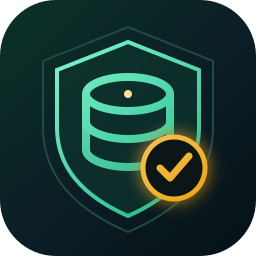

# Secure Student Records Management Control

### **SRMS** — academic records, engineered around five database-security models.

<p>
  <strong>A role-aware student information system that treats confidentiality, integrity, and auditability as first-class features.</strong>
</p>

<p>
  <a href="https://github.com/Ahmedbakr78/Secure-Student-Records-Management-Control/actions/workflows/ci.yml">
    
  </a>
  <a href="https://github.com/Ahmedbakr78/Secure-Student-Records-Management-Control/releases">
    
  </a>
  <a href="LICENSE">
    
  </a>
</p>

<p>
  
  
  
  
</p>

<p>
  
  
  
  
</p>

<p>
  <a href="https://ahmedbakr78.github.io/Secure-Student-Records-Management-Control/"><strong>🌐 Live documentation website</strong></a>
  &nbsp;·&nbsp;
  <a href="https://ahmedbakr78.github.io/Secure-Student-Records-Management-Control/diagrams.html"><strong>Diagram gallery</strong></a>
  &nbsp;·&nbsp;
  <a href="documentation/README.md"><strong>📚 Documentation index</strong></a>
  &nbsp;·&nbsp;
  <a href="https://github.com/Ahmedbakr78/Secure-Student-Records-Management-Control/releases"><strong>🚀 Releases</strong></a>
  &nbsp;·&nbsp;
  <a href="#-quick-start"><strong>⚡ Quick start</strong></a>
</p>

</div>

---

> [!IMPORTANT]
> **Educational reference implementation.** SRMS is a Database Security course project. It ships with public demo accounts and a demo SQL Server password so that reviewers can reproduce the security tests. **Never use the demo credentials, connection settings, or backup with real student data.** Read [Security notes & production hardening](#-security-notes--production-hardening) before deploying anything.

> [!NOTE]
> This repository is the renamed and rebuilt home of the former `Data-Security-Secure-Student-Records-Management-System-SRMS-` project. The application name is now **Secure Student Records Management Control**; the short name remains **SRMS**. The original remote repository was left untouched.

---

## Table of contents

<details open>
<summary><strong>Expand or collapse the full guide</strong></summary>

- [Why this project exists](#-why-this-project-exists)
- [At a glance](#-at-a-glance)
- [Feature matrix](#-feature-matrix)
- [The five security models](#-the-five-security-models)
  - [1. Role-Based Access Control](#1-role-based-access-control-rbac)
  - [2. Multilevel Security](#2-multilevel-security-mls--bell-lapadula)
  - [3. Inference control](#3-inference-control)
  - [4. Flow control](#4-flow-control)
  - [5. Encryption](#5-encryption)
- [System architecture](#-system-architecture)
- [Request lifecycle](#-request-lifecycle)
- [Database design](#-database-design)
  - [Entity relationship diagram](#entity-relationship-diagram)
  - [Table catalog](#table-catalog)
  - [Classification levels](#classification-levels)
  - [Secure views](#secure-views)
  - [Stored procedures](#stored-procedures)
  - [Database roles](#database-roles)
- [Roles, dashboards, and permissions](#-roles-dashboards-and-permissions)
- [Role-upgrade workflow](#-role-upgrade-workflow)
- [Application tour](#-application-tour)
- [Advanced features](#-advanced-features)
- [Technology stack](#-technology-stack)
- [Repository structure](#-repository-structure)
- [Quick start](#-quick-start)
  - [Prerequisites](#prerequisites)
  - [1. Clone the repository](#1-clone-the-repository)
  - [2. Start SQL Server](#2-start-sql-server)
  - [3. Create the database](#3-create-the-database)
  - [4. Install Python dependencies](#4-install-python-dependencies)
  - [5. Configure the application](#5-configure-the-application)
  - [6. Launch the desktop client](#6-launch-the-desktop-client)
  - [Alternative: restore the shipped backup](#alternative-restore-the-shipped-backup)
  - [Alternative: SQLite mode](#alternative-sqlite-mode)
- [Configuration reference](#-configuration-reference)
- [Database setup order](#-database-setup-order)
- [Web database viewer](#-web-database-viewer)
- [Verification and tests](#-verification-and-tests)
- [Security notes & production hardening](#-security-notes--production-hardening)
- [Documentation map](#-documentation-map)
- [Roadmap](#-roadmap)
- [FAQ](#-faq)
- [Contributing](#-contributing)
- [License](#-license)
- [Citation](#-citation)
- [Disclaimer](#-disclaimer)

</details>

---

## 🎯 Why this project exists

Student information systems hold some of the most sensitive records in an institution: identity data, contact details, grades, attendance, disciplinary notes, and the audit trail that proves who changed what. A normal CRUD application is not enough. The system must answer hard questions:

- Can a teaching assistant see grades? **No.**
- Can an instructor read a student's record outside their assigned course? **No.**
- Can a student infer a classmate's grade from an aggregate query? **No.**
- Can secret data be exported, printed, or copied to a lower-classification context? **No.**
- Can an administrator prove who accessed a record and when? **Yes.**
- Can a student request a higher role without bypassing the admin? **Yes — through an audited workflow.**

SRMS is a working answer to those questions. It combines a Python/Tkinter desktop client, a SQL Server database, and an explicit security kernel that enforces five models on every meaningful operation.

### The design promise

| Promise | How SRMS delivers it |
| :-- | :-- |
| **Only the right people see the right rows** | Role-Based Access Control plus row-level "own data" checks |
| **Clearance is respected in both directions** | Bell–LaPadula no-read-up and no-write-down |
| **Aggregates cannot expose individuals** | Minimum query-set size and tracker-attack detection |
| **Classified data cannot leak sideways** | Flow control blocks downward movement, export, print, copy, and save |
| **Sensitive fields are unreadable at rest** | SQL Server AES-256, certificate-backed keys, hashed passwords |
| **Every important action is attributable** | `AUDIT_LOG` with user, role, table, action, timestamp, and outcome |
| **Privilege changes are governed** | Student/TA role requests with admin approval or denial and comments |

---

## 📊 At a glance

| Dimension | Value |
| :-- | :-- |
| **Project name** | Secure Student Records Management Control |
| **Short name** | SRMS |
| **Category** | Database security · academic records · role-based information system |
| **Primary users** | Admin · Instructor · Teaching Assistant · Student · Guest |
| **Security models** | RBAC · MLS (Bell–LaPadula) · Inference control · Flow control · Encryption |
| **Desktop client** | Python 3, Tkinter, ttkbootstrap, custom dark theme |
| **Database** | Microsoft SQL Server 2022 (SQLite development fallback) |
| **DB driver** | `pymssql` for SQL Server; `sqlite3` for the fallback |
| **Web inspector** | Flask read-only database viewer on port `5000` |
| **Database objects** | 11 core tables · 11 secure views · 14 canonical stored procedures · 5 database roles |
| **Sample data** | 8 SQL Server users / 11 SQLite users · 8 students · 5 accessible courses · 10–12 grades · attendance, requests, notifications |
| **Documentation** | 17 long-form guides + 10-page website + 14 Mermaid diagrams and rendered SVGs |
| **License** | GNU Affero General Public License v3.0 (AGPL-3.0) |
| **Release** | `v1.0.0` — 2026-10-27 |

---

## ✨ Feature matrix

<table>
<thead>
<tr>
  <th align="left">Area</th>
  <th align="left">Capability</th>
  <th align="left">Who benefits</th>
</tr>
</thead>
<tbody>
<tr><td><strong>Authentication</strong></td><td>Salted password verification, inactive/locked account checks, failed-attempt counter, five-attempt lockout, last-login tracking</td><td>All roles</td></tr>
<tr><td><strong>RBAC</strong></td><td>Five roles, table-level operations, own-row restrictions, explicit grant/revoke/deny simulation</td><td>All roles</td></tr>
<tr><td><strong>MLS</strong></td><td>Five classification levels, no-read-up, no-write-down, clearance-aware navigation</td><td>Admin · Instructor · TA · Student · Guest</td></tr>
<tr><td><strong>Inference control</strong></td><td>Minimum result-set size of 3, MIN/MAX threshold of 6, complementary-query tracker detection</td><td>Analysts · TAs · Instructors</td></tr>
<tr><td><strong>Flow control</strong></td><td>Downflow prevention, export/print/copy/save blocks by classification, clipboard lock state</td><td>All roles</td></tr>
<tr><td><strong>Encryption</strong></td><td>SQL Server AES-256 hierarchy, Fernet application encryption, bcrypt and SHA-256 password paths</td><td>All roles</td></tr>
<tr><td><strong>Audit</strong></td><td>Login success/failure, access decisions, administrative actions, old/new values, IP field</td><td>Admin · auditors</td></tr>
<tr><td><strong>Role workflow</strong></td><td>Students and TAs submit upgrade requests; admin approves or denies with comments; status is visible to the requester</td><td>Student · TA · Admin</td></tr>
<tr><td><strong>Admin console</strong></td><td>Overview, users, role requests, students, instructors, courses, grades, attendance, audit log, SQL viewer, security dashboard, settings, export</td><td>Admin</td></tr>
<tr><td><strong>Instructor console</strong></td><td>Assigned courses, student roster, grade entry and publishing, attendance view, course analytics</td><td>Instructor</td></tr>
<tr><td><strong>TA console</strong></td><td>Assigned-course attendance recording, student roster, role request, no grade access</td><td>TA</td></tr>
<tr><td><strong>Student console</strong></td><td>Own profile, own published grades, own attendance, course catalog, role request, GPA, transcript, notifications</td><td>Student</td></tr>
<tr><td><strong>Guest console</strong></td><td>Public course information only; every confidential table denied</td><td>Guest</td></tr>
<tr><td><strong>Analytics</strong></td><td>User/student/course/grade counts, grade distribution, attendance summary, recent logins, recent activity</td><td>Admin</td></tr>
<tr><td><strong>Academic tools</strong></td><td>GPA calculator, letter-to-points conversion, transcript generation, transcript export/print</td><td>Student</td></tr>
<tr><td><strong>Data tools</strong></td><td>CSV/JSON import wizard, CSV/JSON/TXT/HTML export, search manager, backup manager</td><td>Admin</td></tr>
<tr><td><strong>Notifications</strong></td><td>In-app notification center, bulk notifications, announcement and email simulation</td><td>All roles</td></tr>
<tr><td><strong>Security console</strong></td><td>Live status cards for RBAC, MLS, inference, flow, encryption; interactive self-tests; full audit report</td><td>Admin</td></tr>
<tr><td><strong>DB inspection</strong></td><td>Read-only Flask viewer for tables, users, students, courses, grades, procedures, views, roles, audit, ad-hoc query</td><td>Developer · reviewer</td></tr>
<tr><td><strong>Developer experience</strong></td><td>One-command launchers, DBeaver integration, verification script, SQL scripts, backup, CI, issue templates</td><td>Developer · instructor</td></tr>
</tbody>
</table>

---

## 🛡 The five security models

### 1. Role-Based Access Control (RBAC)

SRMS assigns every principal one of five roles and checks every table operation against a permission matrix before the database is touched. The matrix distinguishes **full-table operations**, **own-row operations** (`SELECT_OWN`, `UPDATE_OWN`), and **public projections** (`SELECT_PUBLIC`).

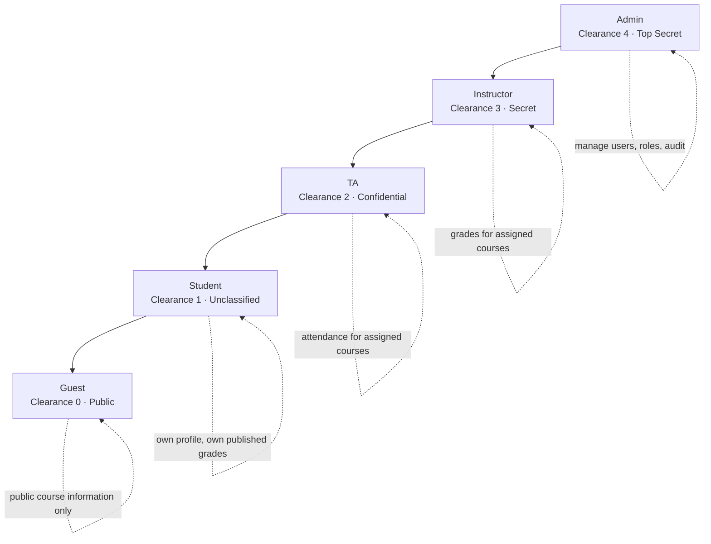

**Implementation**

| Layer | Mechanism |
| :-- | :-- |
| Application | `RBACManager.has_permission(role, table, operation, user_id, target_id)` |
| Permission source | `PERMISSION_MATRIX` in `config.py` |
| Explicit denials | `deny()`, `revoke()`, `grant()` simulate SQL `DENY`, `REVOKE`, `GRANT` |
| Database | `db_Admin`, `db_Instructor`, `db_TA`, `db_Student`, `db_Guest` roles with `GRANT`/`DENY` |
| Row restrictions | Own-data checks and assigned-course filters in views and queries |
| UI | Each dashboard only exposes the navigation and actions allowed for its role |

<details>
<summary><strong>Full application permission matrix</strong></summary>

| Table | Admin | Instructor | TA | Student | Guest |
| :-- | :-- | :-- | :-- | :-- | :-- |
| `STUDENT` | CRUD | R | R (assigned) | R (own) | — |
| `INSTRUCTOR` | CRUD | R, U (own) | — | — | — |
| `COURSE` | CRUD | R | R | R | R (public view) |
| `GRADES` | CRUD | R, I, U (assigned) | — | R (own, published) | — |
| `ATTENDANCE` | CRUD | R (assigned) | R, I, U (assigned) | R (own) | — |
| `USERS` | CRUD | — | — | — | — |
| `ROLE_REQUESTS` | CRUD | R, I (own) | R, I (own) | R, I (own) | — |
| `AUDIT_LOG` | R, I | — | — | — | — |
| `COURSE_ENROLLMENT` | CRUD | R | R | R (own) | — |
| `COURSE_ASSIGNMENT` | CRUD | R | R | — | — |

</details>

---

### 2. Multilevel Security (MLS) — Bell–LaPadula

Every object carries a classification from **0 Public** to **4 Top Secret**. Every subject carries a clearance derived from its role. Two rules are enforced:

- **No Read Up (NRU):** a subject may read an object only when `clearance >= classification`.
- **No Write Down (NWD):** a subject may write to an object only when `clearance <= classification`, with the admin treated as a trusted principal.

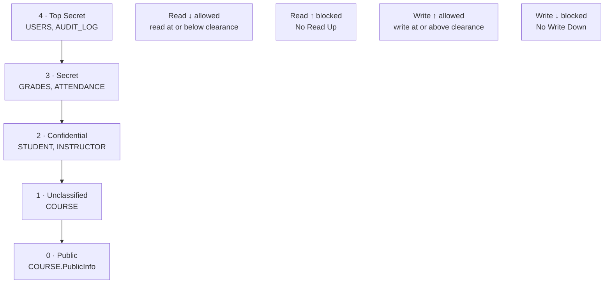

| Role | Clearance | Can read | Can write |
| :-- | :--: | :-- | :-- |
| Admin | 4 | All classifications | All classifications (trusted) |
| Instructor | 3 | Secret and below | Secret, Top Secret |
| TA | 2 | Confidential and below | Confidential, Secret, Top Secret |
| Student | 1 | Unclassified and below, plus own records | Unclassified and above |
| Guest | 0 | Public only | Public and above |

> [!NOTE]
> The course specification treats **Confidential** as level 2 and **Student** as clearance level 1. A student's ability to see their own confidential profile is a controlled exception implemented through ownership checks, not by raising their global clearance.

---

### 3. Inference control

Aggregate queries are useful, but small result sets can expose an individual. SRMS uses **query-set-size control** and a **tracker-attack heuristic**.

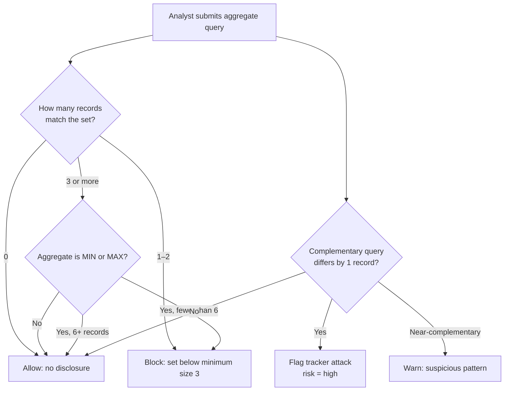

| Rule | Value | Purpose |
| :-- | :--: | :-- |
| Minimum result-set size | 3 | Prevent singling out one record |
| MIN/MAX minimum size | 6 | Protect extreme individual values |
| Query history | 50 per user | Detect complementary queries |
| Tracker detection | Symmetric difference = 1 | Block classic differencing attack |
| Sensitive-field redaction | Role-based | Remove password, salt, grade, phone, clearance fields |

---

### 4. Flow control

Flow control prevents classified information from moving to a context with lower classification. SRMS enforces this at the policy layer and in the GUI.

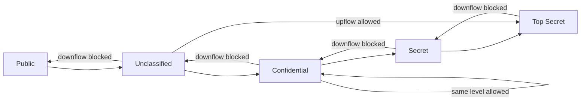

| Action | Public | Unclassified | Confidential | Secret | Top Secret |
| :-- | :--: | :--: | :--: | :--: | :--: |
| View | ✅ | ✅ | ✅ | ✅ | ✅ |
| Export | ✅ | ✅ | ❌ | ❌ | ❌ |
| Print | ✅ | ✅ | ✅ | ❌ | ❌ |
| Copy | ✅ | ✅ | ✅ | ❌ | ❌ |
| Paste | ✅ | ✅ | ✅ | ❌ | ❌ |
| Save | ✅ | ✅ | ✅ | ❌ | ❌ |
| Screenshot | ✅ | ✅ | ✅ | ✅ | ❌ |

The `FlowController` also exposes `can_export`, `can_print`, `can_copy`, `can_save`, `lock_clipboard`, and `enforce_flow` methods so that UI actions and export utilities can call the same policy.

---

### 5. Encryption

SRMS uses **defence in depth** rather than a single cipher call.

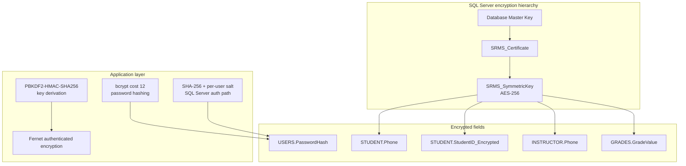

| Layer | Algorithm | Used for | Notes |
| :-- | :-- | :-- | :-- |
| Database | AES-256 symmetric key + certificate | Phone numbers, student ID copy, grade values | `sp_EncryptData`, `sp_DecryptData` |
| Application (SQLite / model path) | Fernet authenticated encryption with PBKDF2-HMAC-SHA256 (100,000 iterations) | Sensitive field values | The Fernet construction is AES-128-CBC + HMAC-SHA256; the project label “AES-256” refers to the database layer and intended key size |
| Password (Python model path) | bcrypt, cost 12, unique salt | `USERS.password_hash` | `EncryptionManager.hash_password` |
| Password (SQL Server path) | SHA-256 + per-user salt | `USERS.PasswordHash` | Matches `HASHBYTES('SHA2_256', password + salt)` in T-SQL |
| Transport | Local TCP to SQL Server | Client ↔ database | TLS is a production requirement |

> [!WARNING]
> Two password paths exist because the project supports both SQL Server and SQLite. This is documented as a known limitation. A production deployment should choose one password-hashing scheme, use a modern memory-hard algorithm such as Argon2id, and rotate secrets through a vault.

---

## 🏗 System architecture

SRMS follows a layered architecture with a deliberately small, auditable security kernel.

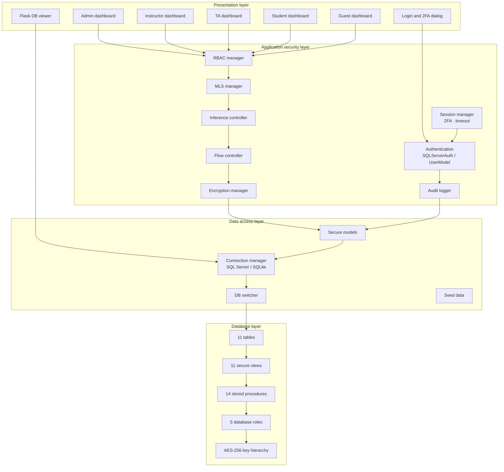

### Component responsibilities

| Component | File | Responsibility |
| :-- | :-- | :-- |
| Application shell | `src/gui/main.py` | Window lifecycle, login screen, role routing |
| Authentication | `src/database/sqlserver_auth.py` | Credential verification, lockout, login audit, user lookup |
| Secure models | `src/database/models.py` | Encrypt/decrypt records, RBAC + MLS checks, audit writes |
| Connection manager | `src/database/connection.py` | Singleton SQL Server or SQLite connection, query helpers |
| DB switcher | `src/database/db_switcher.py` | Runtime backend selection and connection testing |
| RBAC | `src/security/rbac.py` | Permission matrix, grant/revoke/deny, own-row logic |
| MLS | `src/security/mls.py` | Clearance lookup, NRU/NWD, accessible-table filtering |
| Inference control | `src/security/inference_control.py` | Query-set size, aggregate validation, tracker detection, redaction |
| Flow control | `src/security/flow_control.py` | Downflow prevention, action blocking, clipboard lock |
| Encryption | `src/security/encryption.py` | Fernet encryption, PBKDF2 derivation, bcrypt, column helpers |
| Advanced security | `src/security/advanced_security.py` | 2FA simulation, session manager, GPA, transcript, bulk operations |
| Admin dashboard | `src/gui/admin_dashboard.py` | Full administrative console |
| Instructor dashboard | `src/gui/instructor_dashboard.py` | Grade and course management |
| TA dashboard | `src/gui/ta_dashboard.py` | Attendance management |
| Student dashboard | `src/gui/student_dashboard.py` | Personal academic view |
| Guest dashboard | `src/gui/guest_dashboard.py` | Public course catalog |
| Security dashboard | `src/gui/security_dashboard.py` | Live model status and self-tests |
| Analytics | `src/gui/analytics.py` | Charts and system statistics |
| Profile manager | `src/gui/profile_manager.py` | Profile dialog, password strength, theme, reports |
| Student features | `src/gui/student_features.py` | GPA, transcript, enrollment, attendance, notifications |
| Data tools | `src/utils/data_tools.py` | Import/export wizards, search, email simulation, backups |
| Export utilities | `src/utils/export.py` | CSV, Excel, PDF export with classification checks |
| DB viewer | `db_viewer.py` / `web_viewer.py` | Flask read-only database inspector |
| Launchers | `launch.py`, `run.py`, `run_all.sh` | Orchestrate Docker, DBeaver, Flask, and GUI |

### Deployment topology

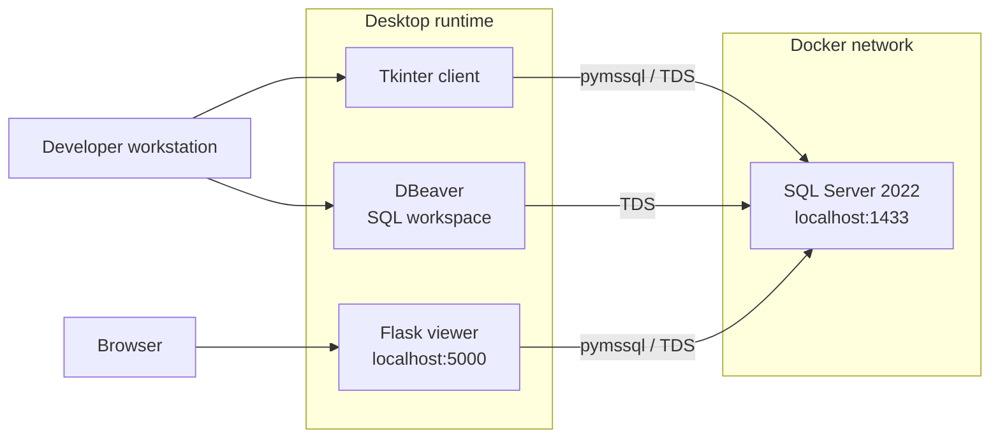

---

## 🔄 Request lifecycle

Every protected operation follows the same path: authenticate, authorise, classify, validate the query shape, enforce flow, apply encryption, audit, and only then return data.

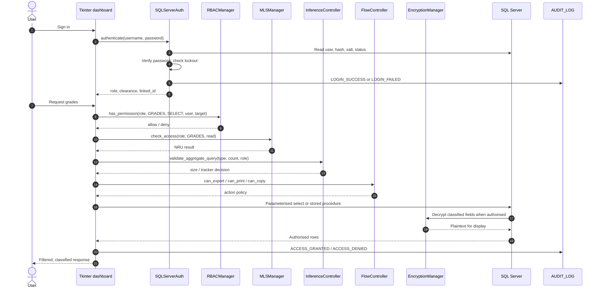

### Failure behaviour

| Failure | User sees | Audit event |
| :-- | :-- | :-- |
| Unknown username | “Invalid credentials” | Generic failure, no account enumeration |
| Wrong password | “Invalid credentials” + remaining attempts | `LOGIN_FAILED` |
| Fifth wrong password | “Account locked” | Lock flag update + audit |
| Insufficient RBAC permission | Access denied message | `ACCESS_DENIED` |
| MLS violation | No Read Up / No Write Down reason | `MLS_VIOLATION` |
| Query set too small | Inference-control explanation | `INFERENCE_BLOCKED` |
| Blocked flow action | “Action not permitted for classification” | `FLOW_BLOCKED` |

---

## 🗄 Database design

### Entity relationship diagram

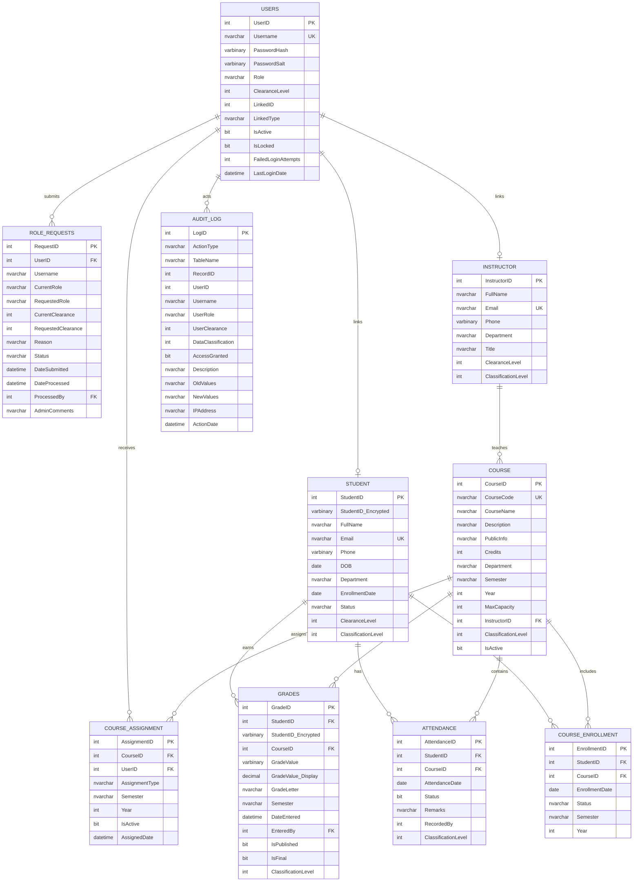

### Table catalog

| # | Table | Classification | Purpose | Encrypted columns |
| :-: | :-- | :-- | :-- | :-- |
| 1 | `SECURITY_CLASSIFICATION` | Reference | Defines the 0–4 classification scale | — |
| 2 | `USERS` | Top Secret | Authentication, role, clearance, account state | `Username_Encrypted`, `PasswordHash`, `PasswordSalt` |
| 3 | `INSTRUCTOR` | Confidential | Instructor identity and department | `Phone` |
| 4 | `STUDENT` | Confidential | Student identity and enrollment state | `Phone`, `StudentID_Encrypted` |
| 5 | `COURSE` | Unclassified | Course catalog and public description | — |
| 6 | `GRADES` | Secret | Grade values and publication state | `GradeValue`, `StudentID_Encrypted` |
| 7 | `ATTENDANCE` | Secret | Per-course attendance | — |
| 8 | `COURSE_ENROLLMENT` | Internal | Student-to-course enrollment | — |
| 9 | `COURSE_ASSIGNMENT` | Internal | Instructor/TA-to-course assignment | — |
| 10 | `ROLE_REQUESTS` | Secret | Role upgrade workflow | — |
| 11 | `AUDIT_LOG` | Top Secret | Security event trail | — |

### Classification levels

| Level | Name | Typical data | Read by | Write by |
| :-: | :-- | :-- | :-- | :-- |
| 0 | **Public** | Public course information | Everyone | Admin |
| 1 | **Unclassified** | Course code, title, credits, description | Guest and above | Admin |
| 2 | **Confidential** | Student and instructor profiles | TA and above | Admin, owner (limited) |
| 3 | **Secret** | Grades and attendance | Instructor and above | Admin, Instructor, TA (attendance) |
| 4 | **Top Secret** | Users, audit log, disciplinary data | Admin | Admin |

### Secure views

| View | Intended consumer | What it restricts |
| :-- | :-- | :-- |
| `vw_PublicCourseInfo` | Guest | Only public course fields |
| `vw_StudentOwnProfile` | Student | Only the current student's profile |
| `vw_StudentOwnGrades` | Student | Only published grades for the current student |
| `vw_StudentOwnAttendance` | Student | Only the current student's attendance |
| `vw_TAAssignedStudents` | TA | Only students in assigned courses |
| `vw_TAAttendance` | TA | Only attendance for assigned courses |
| `vw_InstructorStudents` | Instructor | Only students in assigned courses |
| `vw_InstructorGrades` | Instructor | Only grades for assigned courses |
| `vw_InstructorAttendance` | Instructor | Only attendance for assigned courses |
| `vw_AdminAllData` | Admin | Full authorised view |
| `vw_PendingRoleRequests` | Admin | Only pending requests |

### Stored procedures

| Procedure | Security model | Purpose |
| :-- | :-- | :-- |
| `sp_UserLogin` | Authentication | Verify credentials, track failures, lock account |
| `sp_MLSReadCheck` | MLS | Enforce No Read Up |
| `sp_MLSWriteCheck` | MLS | Enforce No Write Down |
| `sp_MLSAccessCheck` | MLS | Combined read/write decision |
| `sp_GetCourseStatistics` | Inference control | Reject aggregates below the minimum set size |
| `sp_CheckDataFlow` | Flow control | Reject downward data flow |
| `sp_CheckExportAllowed` | Flow control | Reject export of classified data |
| `sp_EncryptData` | Encryption | Encrypt a value with the AES-256 symmetric key |
| `sp_DecryptData` | Encryption | Decrypt an authorised value |
| `sp_InsertGrade` | Encryption + MLS | Insert a grade with encryption and write checks |
| `sp_SubmitRoleRequest` | Role workflow | Create a pending request |
| `sp_GetPendingRoleRequests` | Role workflow | List pending requests for the admin |
| `sp_ProcessRoleRequest` | Role workflow | Approve or deny a request |
| `sp_CreateUser` | RBAC + audit | Create a user with a hashed password |

Legacy compatibility procedures (`usp_SubmitRoleRequest`, `usp_ProcessRoleRequest`, `usp_UpdateGrade`, `usp_UpdateAttendance`, `usp_FlowControlCheck`, `usp_GetSecureStatistics`, `usp_AddUser`) remain in `sql/sqlserver_procedures_fixed.sql` for earlier coursework scripts.

### Database roles

| Role | Core grants | Core denials |
| :-- | :-- | :-- |
| `db_Admin` | CRUD on every business table, execute on schema, view definition | Audit is read/insert only |
| `db_Instructor` | Read students/courses; read/insert/update grades for assigned courses; read attendance | No user access, no student writes, no attendance writes |
| `db_TA` | Read assigned students; read/insert/update attendance; read courses | No grade access, no user access, no student writes |
| `db_Student` | Read own profile, own published grades, own attendance, courses | No other students, no users, no grade writes |
| `db_Guest` | Public course view only | Every base table denied |

---

## 👥 Roles, dashboards, and permissions

### Role hierarchy

| Role | Clearance | Primary responsibility | Cannot do |
| :-- | :-- | :-- | :-- |
| **Admin** | 4 | Users, roles, all records, audit, security dashboard | — |
| **Instructor** | 3 | Grades and academic decisions for assigned courses | Manage users, edit attendance, delete grades |
| **TA** | 2 | Attendance for assigned courses | View or edit grades, manage users |
| **Student** | 1 | View own profile, published grades, attendance, courses | View other students, edit grades, manage users |
| **Guest** | 0 | View public course information | Access any confidential table |

### Dashboard map

| Dashboard | Tabs / views |
| :-- | :-- |
| **Login** | Branding panel, username/password, demo account shortcuts, guest entry |
| **Admin** | Overview, Users, Role Requests, Students, Instructors, Courses, Grades, Attendance, Audit Log, SQL Viewer, Security Dashboard, Settings |
| **Instructor** | Overview, My Courses, Grades, Students, Attendance |
| **TA** | Overview, Attendance, Students, Role Request |
| **Student** | My Profile, My Grades, Attendance, Courses, Role Request, GPA, Transcript, Notifications |
| **Guest** | Access explanation, public course catalog |

### Demo accounts

| Username | Password | Role | Clearance | Linked record |
| :-- | :-- | :-- | :--: | :-- |
| `admin` | `admin123` | Admin | 4 | — |
| `prof_smith` | `prof123` | Instructor | 3 | Instructor 1 |
| `prof_johnson` | `prof123` | Instructor | 3 | Instructor 2 |
| `prof_jones` | `prof123` | Instructor | 3 | Instructor 2 (seed path) |
| `ta_williams` | `ta123` | TA | 2 | — |
| `ta_brown` | `ta123` | TA | 2 | — |
| `student1` | `student123` | Student | 1 | Student 1 |
| `student2` | `student123` | Student | 1 | Student 2 |
| `student3` … `student5` | `student123` | Student | 1 | Students 3–5 (seed path) |
| `guest` | `guest123` | Guest | 0 | — |

> [!CAUTION]
> These credentials are published for classroom reproduction only. Delete or rotate them before any non-demo deployment.

---

## 🔁 Role-upgrade workflow

The Part B workflow gives lower-privilege users a governed path to request a higher role.

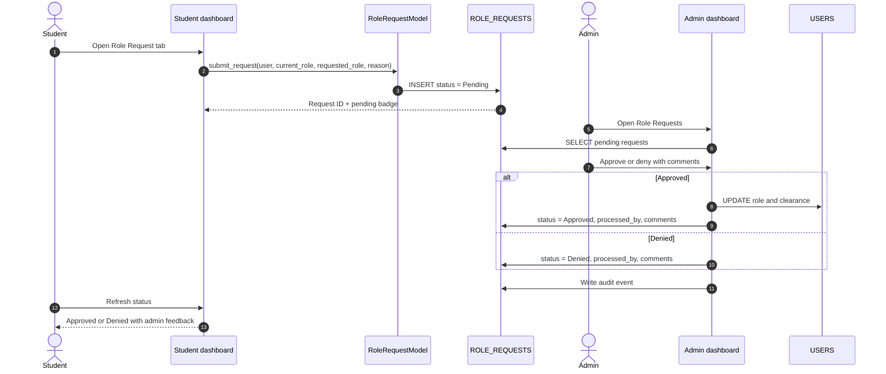

### Workflow rules

- Requested roles are limited to `TA` and `Instructor`.
- A request starts as `Pending`; only an admin can process it.
- Approval updates the role and clearance in `USERS`.
- Denial leaves the role unchanged.
- Every transition is written to `AUDIT_LOG`.
- Admin comments are stored and shown to the requester.
- Duplicate or invalid requests are rejected by the model and database constraints.

---

## 🖥 Application tour

### Login and authentication

- Split-screen dark interface with security badges.
- Demo-account shortcuts for fast evaluation.
- Guest entry without credentials (or with the demo guest account).
- Account lockout after five failed attempts.
- Optional two-factor dialog simulation with a six-digit code, five-minute expiry, and three-attempt limit.
- Session manager with a configurable timeout (30 minutes by default).

### Admin experience

The admin dashboard is the operations centre:

1. **Overview** — counts for users, students, instructors, courses, grades, attendance, pending requests, and recent activity.
2. **Users** — search, filter, add users, inspect role and clearance, view last login.
3. **Role Requests** — review reasons, approve or deny, add admin comments, see processed history.
4. **Students** — roster with department, status, and masked contact display.
5. **Instructors** — roster with department, title, and assignment context.
6. **Courses** — catalog with instructor, credits, semester, capacity, and classification.
7. **Grades** — grade records, publication state, encrypted values, and export.
8. **Attendance** — per-course attendance overview.
9. **Audit Log** — action type, table, user, role, access result, and timestamp.
10. **SQL Viewer** — inspect the SQL objects that back the system.
11. **Security Dashboard** — live status and interactive tests for all five models.
12. **Settings** — theme, security preferences, audit maintenance, database export.

### Instructor experience

- Overview of assigned courses, student counts, grades, and attendance.
- Course list with classification and assignment information.
- Grade entry and update restricted to assigned courses.
- Student roster restricted to assigned courses.
- Attendance view.
- Instructor header explicitly states allowed actions: *Read Students, Create/Update Grades*.

### TA experience

- Overview with a plain-language RBAC permission panel.
- Attendance entry, update, and course filtering.
- Assigned-student roster.
- Role request tab.
- No grades anywhere in the UI or database grants.

### Student experience

- Personal profile and masked contact information.
- Own grades, only when published.
- Own attendance record and attendance rate.
- Course catalog and enrollment manager.
- Role request submission and status.
- GPA calculator with letter-to-points conversion and academic standing.
- Transcript viewer with export and print.
- Notification centre with mark-as-read and mark-all-read.
- Export and print are blocked for classified contexts by flow control.

### Guest experience

- Explicit access-level explanation.
- Public course catalog only.
- No confidential table access.
- Clear path to register as a student.

---

## 🚀 Advanced features

| Feature | What it does | Security note |
| :-- | :-- | :-- |
| **2FA simulation** | Six-digit code, five-minute expiry, three attempts | Simulation only; not a real TOTP secret |
| **Session manager** | Creates hashed session IDs, validates activity, refreshes, expires | Default 30-minute timeout |
| **GPA calculator** | Converts letter grades to points, computes cumulative GPA and standing | Reads only authorised grades |
| **Transcript generator** | Builds a transcript dict and text export | Export blocked for classified contexts |
| **Bulk operations** | Publish grades, mark attendance, create notifications | Admin/Instructor scoped |
| **Data import wizard** | CSV/JSON upload, preview, column mapping, confirmation | Admin-only in the UI |
| **Data export wizard** | CSV, JSON, TXT, HTML, Excel, PDF | Flow-control checks before export |
| **Search manager** | Cross-entity search with role-aware results | Redacts restricted fields |
| **Backup manager** | Creates and lists database backups | Demo backup is not encrypted |
| **Email simulation** | Template-based local email log | No real messages are sent |
| **Notification centre** | In-app alerts, mark read, bulk notify | User-scoped |
| **Security dashboard** | Status cards, test buttons, full audit report | Admin-only |
| **Flask DB viewer** | Browse tables, views, procedures, roles, audit, ad-hoc query | Read-only; localhost only |
| **DBeaver integration** | Opens the SQL scripts and schema in a DBA tool | Optional |
| **Verification script** | Imports, database, models, authentication, role requests, SQL assets | Should be run in a configured environment |

---

## 🧰 Technology stack

| Layer | Technology | Version / notes |
| :-- | :-- | :-- |
| Language | Python | 3.10+ recommended |
| Desktop UI | Tkinter | Standard library |
| UI theme | ttkbootstrap | Optional enhancement; fallback to ttk |
| Charts | Matplotlib, Seaborn | Analytics and distributions |
| Database | Microsoft SQL Server | 2022 image used by the launcher |
| DB driver | pymssql | SQL Server connectivity |
| Alternate driver | pyodbc | Installed for ODBC scenarios |
| Fallback DB | SQLite | `database/srms.db` + `schema.sql` |
| Web viewer | Flask | Read-only inspector |
| Crypto | `cryptography`, `bcrypt` | Fernet, PBKDF2, bcrypt |
| Export | openpyxl, fpdf2 | Excel and PDF |
| Data | python-dateutil | Date handling |
| Diagrams | Mermaid | README, docs, and website |
| Website | Static HTML/CSS/JS | GitHub Pages |
| CI | GitHub Actions | Syntax and documentation checks |

---

## 📁 Repository structure

```text
Secure-Student-Records-Management-Control/
├── .github/
│   ├── CODEOWNERS
│   ├── dependabot.yml
│   ├── ISSUE_TEMPLATE/
│   │   ├── bug_report.yml
│   │   ├── config.yml
│   │   └── feature_request.yml
│   ├── PULL_REQUEST_TEMPLATE.md
│   └── workflows/
│       └── ci.yml
├── config.py                      # Roles, classifications, permissions, theme
├── database/
│   ├── schema.sql                 # SQLite schema
│   ├── sqlserver_*.sql            # SQL Server copies for convenience
│   └── srms.db                    # SQLite demo database
├── db_viewer.py                   # Flask read-only database viewer
├── docs/                          # GitHub Pages website
│   ├── .nojekyll
│   ├── index.html
│   ├── architecture.html
│   ├── security.html
│   ├── database.html
│   ├── setup.html
│   ├── testing.html
│   ├── faq.html
│   ├── docs.html
│   ├── diagrams.html
│   ├── 404.html
│   ├── styles.css
│   ├── script.js
│   └── assets/
│       ├── brand/
│       ├── diagrams/
│       ├── report/
│       └── og-image.png
├── documentation/                 # Long-form Markdown guides
│   ├── README.md
│   ├── 01-overview.md
│   ├── 02-architecture.md
│   ├── 03-security-models.md
│   ├── 04-database-reference.md
│   ├── 05-installation.md
│   ├── 06-user-guide.md
│   ├── 07-testing.md
│   ├── 08-modules.md
│   ├── 09-deployment.md
│   ├── 10-troubleshooting.md
│   ├── 11-faq.md
│   ├── 12-roadmap.md
│   ├── 13-threat-model.md
│   ├── 14-glossary.md
│   ├── 15-project-structure.md
│   ├── 16-role-workflow.md
│   └── diagrams/                  # Mermaid sources
├── launch.py                      # Master launcher: Docker, DBeaver, Flask, GUI
├── run.py                         # DBeaver + GUI launcher
├── run_all.sh                     # Shell launcher
├── run_with_dbeaver.sh            # DBeaver helper
├── requirements.txt
├── sql/
│   ├── sqlserver_schema.sql
│   ├── sqlserver_roles.sql
│   ├── sqlserver_views.sql
│   ├── sqlserver_procedures.sql
│   ├── sqlserver_procedures_fixed.sql
│   ├── sqlserver_sample_data.sql
│   ├── sqlserver_roles_views.sql
│   ├── schema.sql
│   └── security_checker.sql
├── src/
│   ├── database/                  # Connection, models, auth, switcher, seed
│   ├── gui/                       # Login, dashboards, components, theme, analytics
│   ├── security/                  # RBAC, MLS, inference, flow, encryption, advanced
│   └── utils/                     # Export, data tools, shortcuts
├── web_viewer.py                  # Copy of the Flask viewer
├── verify_project.py              # Import, DB, model, auth, and asset checks
├── SRMS_SecureDB.bak              # SQL Server demo backup
├── d_ds.pdf                       # Original architecture diagram export
├── README.md
├── CHANGELOG.md
├── CONTRIBUTING.md
├── CODE_OF_CONDUCT.md
├── SECURITY.md
├── SUPPORT.md
├── CITATION.cff
├── ROADMAP.md
└── LICENSE                        # AGPL-3.0
```

---

## ⚡ Quick start

### Prerequisites

| Requirement | Recommended | Why |
| :-- | :-- | :-- |
| Python | 3.10+ | Type hints, modern syntax |
| Docker | 24+ | Run SQL Server without a local install |
| SQL Server | 2022 | Database features and T-SQL |
| DBeaver | Latest | Optional SQL workspace |
| OS | Linux, macOS, Windows | Tkinter availability varies |

### 1. Clone the repository

```bash
git clone https://github.com/Ahmedbakr78/Secure-Student-Records-Management-Control.git
cd "Secure-Student-Records-Management-Control"
```

### 2. Start SQL Server

```bash
docker run \
  -e 'ACCEPT_EULA=Y' \
  -e 'MSSQL_SA_PASSWORD=Srms@2024!' \
  -p 1433:1433 \
  --name sqlserver2022 \
  --hostname sqlserver \
  -d mcr.microsoft.com/mssql/server:2022-latest
```

Wait for the server to become ready:

```bash
docker logs -f sqlserver2022
```

### 3. Create the database

```bash
docker exec -it sqlserver2022 \
  /opt/mssql-tools18/bin/sqlcmd \
  -S localhost -U SA -P 'Srms@2024!' -C \
  -Q "IF DB_ID('SRMS_SecureDB') IS NULL CREATE DATABASE SRMS_SecureDB;"
```

Then run the scripts **in this exact order**:

```bash
docker exec -i sqlserver2022 /opt/mssql-tools18/bin/sqlcmd \
  -S localhost -U SA -P 'Srms@2024!' -C -d SRMS_SecureDB \
  < sql/sqlserver_schema.sql

docker exec -i sqlserver2022 /opt/mssql-tools18/bin/sqlcmd \
  -S localhost -U SA -P 'Srms@2024!' -C -d SRMS_SecureDB \
  < sql/sqlserver_roles.sql

docker exec -i sqlserver2022 /opt/mssql-tools18/bin/sqlcmd \
  -S localhost -U SA -P 'Srms@2024!' -C -d SRMS_SecureDB \
  < sql/sqlserver_views.sql

docker exec -i sqlserver2022 /opt/mssql-tools18/bin/sqlcmd \
  -S localhost -U SA -P 'Srms@2024!' -C -d SRMS_SecureDB \
  < sql/sqlserver_procedures.sql

docker exec -i sqlserver2022 /opt/mssql-tools18/bin/sqlcmd \
  -S localhost -U SA -P 'Srms@2024!' -C -d SRMS_SecureDB \
  < sql/sqlserver_sample_data.sql
```

> [!TIP]
> The scripts contain `GO` batch separators. Use `sqlcmd` or Azure Data Studio rather than a driver that sends the whole file as one batch.

### 4. Install Python dependencies

```bash
python3 -m venv .venv
source .venv/bin/activate
python -m pip install --upgrade pip
pip install -r requirements.txt
```

On Windows:

```powershell
python -m venv .venv
.venv\Scripts\Activate.ps1
pip install -r requirements.txt
```

### 5. Configure the application

The demo defaults live in `src/database/connection.py`:

```python
DATABASE_TYPE = 'sqlserver'

SQLSERVER_CONFIG = {
    'server': 'localhost',
    'port': 1433,
    'database': 'SRMS_SecureDB',
    'user': 'SA',
    'password': 'Srms@2024!',
}
```

Set a master key for the application encryption layer:

```bash
export SRMS_MASTER_KEY="replace-with-a-long-random-secret"
```

> [!WARNING]
> Change the database credentials and master key before using any non-demo data. See [Configuration reference](#-configuration-reference).

### 6. Launch the desktop client

```bash
python src/gui/main.py
```

Or use a launcher:

```bash
# Master launcher: Docker + DBeaver + Flask + GUI
python launch.py

# DBeaver + GUI
python run.py

# Shell workflow
bash run_all.sh
```

The login screen offers shortcuts for `admin`, `prof_smith`, and `student1`, plus guest access.

### Alternative: restore the shipped backup

A 10 MB SQL Server backup is included as `SRMS_SecureDB.bak`.

```bash
docker cp SRMS_SecureDB.bak sqlserver2022:/var/opt/mssql/backup/

docker exec -it sqlserver2022 \
  /opt/mssql-tools18/bin/sqlcmd \
  -S localhost -U SA -P 'Srms@2024!' -C \
  -Q "RESTORE DATABASE SRMS_SecureDB FROM DISK = '/var/opt/mssql/backup/SRMS_SecureDB.bak' WITH REPLACE;"
```

If the backup was created with different data-file paths, add `MOVE` clauses. Use `RESTORE FILELISTONLY` to inspect logical names first.

### Alternative: SQLite mode

The project includes a SQLite schema and a seeded `database/srms.db` for environments where SQL Server is unavailable.

1. Set `DATABASE_TYPE = 'sqlite'` in `src/database/connection.py`, or call the switcher at runtime.
2. Ensure `database/srms.db` exists.
3. Launch the same GUI.

SQLite mode is for development and demonstrations. It does not provide SQL Server roles, `GRANT`/`DENY`, or T-SQL stored procedures.

---

## ⚙ Configuration reference

| Setting | Location | Purpose | Recommended production value |
| :-- | :-- | :-- | :-- |
| `DATABASE_TYPE` | `src/database/connection.py` | Selects `sqlserver` or `sqlite` | Explicit environment variable |
| `SQLSERVER_CONFIG` | `src/database/connection.py` | Server, port, database, user, password | Loaded from a secret manager |
| `SRMS_MASTER_KEY` | Environment | Application-layer encryption key | 32+ random bytes, rotated and vaulted |
| `MIN_QUERY_SET_SIZE` | `config.py` | Inference-control minimum | 3 (or stricter) |
| `ROLE_CLEARANCE` | `config.py` | Role-to-clearance mapping | Reviewed by data owner |
| `DATA_CLASSIFICATION` | `config.py` | Table-to-classification mapping | Reviewed by data owner |
| `PERMISSION_MATRIX` | `config.py` | Application RBAC rules | Mirrored in database grants |
| `BLOCKED_ACTIONS` | `config.py` | Flow-control action policy | Reviewed by security team |
| `SESSION_TIMEOUT` | `src/security/advanced_security.py` | Session expiry | 15–30 minutes |
| SQL Server roles | `sql/sqlserver_roles.sql` | Database-layer RBAC | Least privilege |
| Flask port | `db_viewer.py` | Web viewer | Bind to `127.0.0.1` |

> [!NOTE]
> The current code stores connection settings directly in `src/database/connection.py`. This is deliberate for classroom reproducibility and is listed as a production-hardening item. Do not copy this pattern into a real deployment.

---

## 🧱 Database setup order

| Step | Script | What it creates |
| :-: | :-- | :-- |
| 1 | `sql/sqlserver_schema.sql` | Master key, certificate, symmetric key, classification table, 10 business tables, indexes |
| 2 | `sql/sqlserver_roles.sql` | `db_Admin`, `db_Instructor`, `db_TA`, `db_Student`, `db_Guest` with grants and denials |
| 3 | `sql/sqlserver_views.sql` | 11 role-aware views |
| 4 | `sql/sqlserver_procedures.sql` | 14 security and workflow procedures |
| 5 | `sql/sqlserver_sample_data.sql` | Demo users, students, instructors, courses, grades, attendance, role request |
| 6 | `sql/security_checker.sql` | Optional security verification queries |
| — | `SRMS_SecureDB.bak` | Full database backup alternative |

> [!IMPORTANT]
> `sqlserver_schema.sql` starts with a `USE SRMS_SecureDB;` batch and drops existing tables. Create the database first, and never run it against a database containing real records.

---

## 🌐 Web database viewer

SRMS includes a Flask inspector for tables, views, procedures, roles, audit entries, and ad-hoc read-only queries.

```bash
python db_viewer.py
```

Open <http://localhost:5000>.

| Route | Purpose |
| :-- | :-- |
| `/` | Dashboard with table counts |
| `/tables` | List all tables |
| `/table/<name>` | Browse a table (allow-listed names) |
| `/users` | User accounts |
| `/students` | Student records |
| `/courses` | Course catalog |
| `/grades` | Grade records |
| `/procedures` | Stored procedures |
| `/procedure/<name>` | Procedure definition |
| `/views` | Secure views |
| `/roles` | Database roles |
| `/audit` | Audit log |
| `/query` | Ad-hoc query form |

> [!CAUTION]
> The viewer is an inspection tool. It is not a production API, has no authentication layer of its own, and should only bind to localhost.

---

## ✅ Verification and tests

### Automated verification script

```bash
python verify_project.py
```

The script checks:

- Imports for configuration, database, models, five security modules, and six GUI modules.
- Database connectivity and the presence of required tables.
- RBAC role definitions and permission access.
- MLS manager availability.
- Inference-control minimum set size.
- Flow-control controller availability.
- Encryption round-trip.
- Authentication for Admin, Instructor, TA, Student, and Guest accounts.
- Role-request model availability.
- SQL Server scripts in `database/`.

> [!NOTE]
> Run verification only after SQL Server or SQLite is configured. The script is not executed as part of the documentation build for this release.

### Security test matrix

| ID | Test | Expected result |
| :-- | :-- | :-- |
| `TC-RBAC-01` | Guest views grades | Denied |
| `TC-RBAC-02` | Student edits a grade | Denied |
| `TC-RBAC-03` | TA views grades | Denied |
| `TC-RBAC-04` | Instructor edits a grade for an assigned course | Allowed |
| `TC-RBAC-05` | Admin manages users | Allowed |
| `TC-INF-01` | Aggregate returns 2 records | Blocked |
| `TC-INF-02` | Aggregate returns 5 records | Allowed |
| `TC-INF-03` | TA queries another course | Denied |
| `TC-FLOW-01` | Copy Secret data to a Public context | Blocked |
| `TC-FLOW-02` | Export grades as CSV | Blocked |
| `TC-FLOW-03` | Copy/paste in a classified GUI context | Disabled |
| `TC-MLS-01` | Student reads Secret data | Denied (No Read Up) |
| `TC-MLS-02` | Admin writes to Public | Allowed as trusted principal; NWD policy documented |
| `TC-MLS-03` | Instructor reads Confidential data | Allowed |
| `TC-ENC-01` | View an encrypted grade | Decrypted for authorised display |
| `TC-ENC-02` | Direct database select of ciphertext | Encrypted bytes |
| `TC-ENC-03` | Password storage | Hash + salt, never plaintext |
| `TC-PB-01` | Student submits a role request | Stored as Pending |
| `TC-PB-02` | Admin approves | Role updated |
| `TC-PB-03` | Admin denies | Role unchanged |

### Manual quality checks

- [ ] All five demo roles can sign in.
- [ ] A student cannot see another student's grades.
- [ ] A TA cannot open a grades view.
- [ ] A guest sees only public course fields.
- [ ] A small aggregate query is rejected with a clear message.
- [ ] An export of Secret data is blocked.
- [ ] Admin can approve and deny role requests.
- [ ] Audit log records both success and denial events.
- [ ] Account lockout occurs after five failed passwords.
- [ ] The Flask viewer loads all allow-listed tables.

---

## 🔐 Security notes & production hardening

SRMS demonstrates security concepts; it is not a hardened product. The most important gaps and their fixes:

| Risk | Current state | Recommended fix |
| :-- | :-- | :-- |
| Public demo credentials | Documented accounts | Remove, rotate, and require onboarding |
| `SA` account | Used by launcher and config | Create a least-privilege application login |
| Hard-coded secrets | Connection settings in source | Environment variables or secret manager |
| 2FA simulation | Dialog-generated code | Real TOTP with encrypted secret storage |
| Email simulation | Local log only | Transactional provider with rate limits |
| Mixed password hashing | bcrypt and SHA-256 paths | One modern algorithm (Argon2id or bcrypt) |
| Application encryption | Fernet fallback plus SQL AES | One key-management design with rotation |
| No HTTPS | Local desktop and Flask | TLS termination and secure cookies |
| No rate limiting | Login counter only | IP + account throttling |
| Audit storage | Local table | Append-only, centralised, tamper-evident |
| Backup handling | Unencrypted `.bak` | Encrypted backups with access control |
| No automated tests | Manual verification | Add unit, integration, and regression suites |
| No privacy workflow | Sample data only | Data-retention and subject-access process |

See [SECURITY.md](SECURITY.md) and [the threat model](documentation/13-threat-model.md) for the full analysis.

---

## 📚 Documentation map

| Guide | What it covers |
| :-- | :-- |
| [Documentation index](documentation/README.md) | Reading paths and full index |
| [01 · Overview](documentation/01-overview.md) | Problem, scope, goals, and success criteria |
| [02 · Architecture](documentation/02-architecture.md) | Layers, modules, request lifecycle, deployment |
| [03 · Security models](documentation/03-security-models.md) | RBAC, MLS, inference, flow, encryption in depth |
| [04 · Database reference](documentation/04-database-reference.md) | Tables, views, procedures, roles, scripts |
| [05 · Installation](documentation/05-installation.md) | Step-by-step setup for SQL Server and SQLite |
| [06 · User guide](documentation/06-user-guide.md) | Role-by-role walkthrough |
| [07 · Testing](documentation/07-testing.md) | Test matrix, evidence, and QA checklist |
| [08 · Modules](documentation/08-modules.md) | File-by-file and class-by-class reference |
| [09 · Deployment](documentation/09-deployment.md) | Local, Docker, CI, and Pages deployment |
| [10 · Troubleshooting](documentation/10-troubleshooting.md) | Common failures and fixes |
| [11 · FAQ](documentation/11-faq.md) | Frequently asked questions |
| [12 · Roadmap](documentation/12-roadmap.md) | Development plan and non-goals |
| [13 · Threat model](documentation/13-threat-model.md) | Assets, actors, threats, mitigations |
| [14 · Glossary](documentation/14-glossary.md) | Security and database terms |
| [15 · Project structure](documentation/15-project-structure.md) | Every folder and file explained |
| [16 · Role workflow](documentation/16-role-workflow.md) | Part B end-to-end workflow |
| [Website](https://ahmedbakr78.github.io/Secure-Student-Records-Management-Control/) | Interactive long-form documentation |

---

## 🗺 Roadmap

| Horizon | Focus |
| :-- | :-- |
| **Now** | Documentation release, website, diagrams, metadata, release assets |
| **Next** | Remove demo secrets, unify encryption, add automated security tests |
| **Then** | Real TOTP, Docker Compose, accessibility, Arabic/RTL, migrations |
| **Later** | ABAC, purpose-based access, differential privacy, tamper-evident audit |

See [ROADMAP.md](ROADMAP.md) for the complete checklist.

---

## ❓ FAQ

<details>
<summary><strong>Is this a production student information system?</strong></summary>

No. It is an educational reference implementation for database-security coursework. It demonstrates the controls, but it has known gaps that must be fixed before handling real records.
</details>

<details>
<summary><strong>Does it really enforce five security models?</strong></summary>

Yes. RBAC, MLS (Bell–LaPadula), inference control, flow control, and encryption are implemented in Python and, for several controls, mirrored in SQL Server stored procedures and roles. The [security guide](documentation/03-security-models.md) maps each model to its code and tests.
</details>

<details>
<summary><strong>Why are the demo passwords public?</strong></summary>

So instructors and reviewers can reproduce every role and test without a setup step. They are intentionally insecure for production and must be removed.
</details>

<details>
<summary><strong>Does the app run without SQL Server?</strong></summary>

Yes, through the SQLite fallback. SQLite mode lacks T-SQL stored procedures, database roles, and the SQL Server encryption hierarchy, so it is best for development and UI evaluation.
</details>

<details>
<summary><strong>Is AES-256 used everywhere?</strong></summary>

The SQL Server layer uses AES-256. The Python application layer uses Fernet, which is authenticated encryption built from AES-128-CBC and HMAC-SHA256, with PBKDF2-HMAC-SHA256 key derivation. The documentation states both accurately.
</details>

<details>
<summary><strong>Can a student see another student's grades?</strong></summary>

No. RBAC own-row checks, the `vw_StudentOwnGrades` view, MLS, and the student dashboard all restrict access to the linked student's published grades.
</details>

<details>
<summary><strong>Can a TA see grades?</strong></summary>

No. The TA role has no GRADES permission at the application layer, and the SQL Server `db_TA` role is explicitly denied on the table.
</details>

<details>
<summary><strong>What is the role-request workflow?</strong></summary>

A student or TA submits a request with a reason. It becomes `Pending`. An admin reviews it and approves or denies it with comments. Approval updates the user's role and clearance; denial leaves the role unchanged. See [the workflow guide](documentation/16-role-workflow.md).
</details>

<details>
<summary><strong>Where is the audit trail?</strong></summary>

In the `AUDIT_LOG` table. The admin dashboard exposes an Audit Log view, and the Flask viewer has an `/audit` route.
</details>

<details>
<summary><strong>Why does the database schema drop tables?</strong></summary>

`sqlserver_schema.sql` is a repeatable classroom setup script. It drops existing objects to guarantee a clean state. Never run it against a database with real data.
</details>

<details>
<summary><strong>How do I change the app name or branding?</strong></summary>

The canonical name is **Secure Student Records Management Control** and the short name is **SRMS**. Update the README, website, `src/gui/main.py` labels, and documentation together. Keep the repository slug stable after publication.
</details>

<details>
<summary><strong>Can I contribute?</strong></summary>

Yes. Read [CONTRIBUTING.md](CONTRIBUTING.md), follow the Code of Conduct, and never include secrets or real student data.
</details>

---

## 🤝 Contributing

Contributions are welcome in documentation, security review, tests, accessibility, and UI polish.

1. Read [CONTRIBUTING.md](CONTRIBUTING.md).
2. Follow the [Code of Conduct](CODE_OF_CONDUCT.md).
3. Open an issue using the templates.
4. Keep pull requests focused and documented.
5. Report vulnerabilities privately via [SECURITY.md](SECURITY.md).

---

## 📄 License

This project is licensed under the **GNU Affero General Public License v3.0**. See [LICENSE](LICENSE) for the full text.

You may use, study, modify, and distribute the software under the terms of the license. If you run a modified version as a network service, the AGPL requires you to offer the corresponding source to users of that service.

---

## 📝 Citation

If you reference this project in academic work, use the metadata in [CITATION.cff](CITATION.cff):

```bibtex
@software{abobakr_srms_2026,
  author       = {Ahmed Abo Bakr},
  title        = {Secure Student Records Management Control (SRMS)},
  year         = {2026},
  version      = {1.0.0},
  license      = {AGPL-3.0},
  url          = {https://github.com/Ahmedbakr78/Secure-Student-Records-Management-Control}
}
```

---

## ⚠️ Disclaimer

SRMS is provided **as-is**, without warranty of any kind. It is a teaching project, not a certified secure system. The authors and contributors are not responsible for data loss, security incidents, regulatory violations, or other damages arising from its use.

- Do not store real student records in this repository or its demo database.
- Do not expose the Flask viewer or SQL Server to the public internet.
- Do not rely on the demo credentials, backup, or simulations in production.
- Review the [threat model](documentation/13-threat-model.md) and [security policy](SECURITY.md) before any deployment.

---

<div align="center">

<p>
  <strong>Built to make database security visible, testable, and teachable.</strong>
</p>

<p>
  <a href="https://github.com/Ahmedbakr78"></a>
  <a href="https://ahmedbakr78.github.io/Secure-Student-Records-Management-Control/"></a>
  <a href="https://github.com/Ahmedbakr78/Secure-Student-Records-Management-Control/releases"></a>
</p>

<sub>Secure Student Records Management Control · SRMS · AGPL-3.0 · 2026</sub>

</div>
