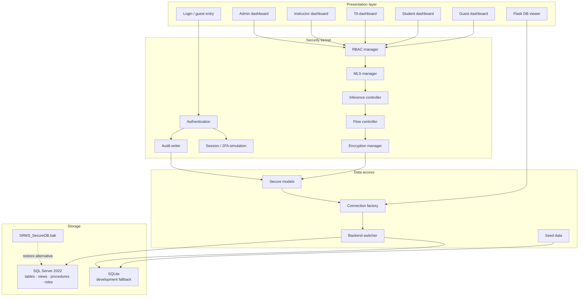
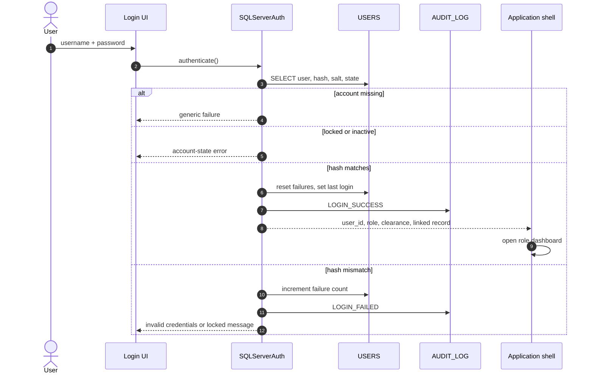
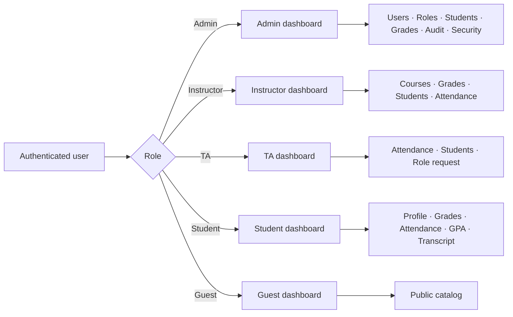
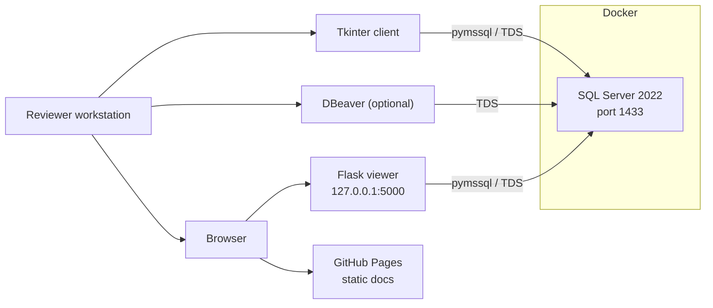

# 02 · Architecture

## Architectural summary

SRMS is a local-first, layered desktop application. A Tkinter presentation layer talks to a Python security kernel and data-access layer, which in turn talks to either SQL Server 2022 or a SQLite fallback. A separate Flask process exposes a read-only database inspector.



The diagram describes the intended path for protected operations. Some existing GUI paths call models directly; the security kernel is most consistently applied where data crosses from a dashboard into a model or authentication service.

---

## Layers

### Presentation layer

| Module | Responsibility | Security relevance |
| :-- | :-- | :-- |
| `src/gui/main.py` | Application shell, login flow, role routing, session lifecycle | Chooses the dashboard after authentication |
| `src/gui/login.py` | Login UI, demo shortcuts, guest entry, lockout messaging | Handles credentials and avoids account enumeration |
| `src/gui/admin_dashboard.py` | Administrative console | Exposes user, role, audit, security, and data operations |
| `src/gui/instructor_dashboard.py` | Assigned courses and grade entry | Restricts operations by course assignment |
| `src/gui/ta_dashboard.py` | Attendance and roster | Demonstrates denied grade access |
| `src/gui/student_dashboard.py` | Own academic records | Own-row enforcement and published-grade filtering |
| `src/gui/guest_dashboard.py` | Public catalog | Public-only projection |
| `src/gui/security_dashboard.py` | Control status and self-tests | Makes security decisions inspectable |
| `src/gui/profile_manager.py` | Profile, theme, reports | User-scoped changes |
| `src/gui/student_features.py` | GPA, transcript, enrollment, notifications | Classification-aware export controls |
| `src/gui/analytics.py` | Counts and distributions | Admin analytics and settings |
| `src/gui/components.py`, `widgets.py`, `dashboard_components.py` | Reusable UI widgets | Consistent status and notification patterns |
| `db_viewer.py`, `web_viewer.py` | Flask inspector | Read-only, localhost-only review tool |

The presentation layer is not trusted to make final security decisions. It is responsible for showing the reason for a decision and for not exposing actions that the policy layer will reject.

### Security kernel

| Module | Public entry point | Responsibility |
| :-- | :-- | :-- |
| `src/security/rbac.py` | `get_rbac_manager()` | Permission matrix, own-row checks, grant/revoke/deny, denial reasons |
| `src/security/mls.py` | `get_mls_manager()` | Clearance lookup, NRU/NWD, accessible-table filtering, record filtering |
| `src/security/inference_control.py` | `get_inference_controller()` | Query-set size, MIN/MAX threshold, tracker detection, redaction |
| `src/security/flow_control.py` | `get_flow_controller()` | Flow direction, action blocking, clipboard lock |
| `src/security/encryption.py` | `get_encryption_manager()` | Fernet encryption, PBKDF2 derivation, bcrypt, column helpers |
| `src/security/advanced_security.py` | `get_tfa_manager()`, `get_session_manager()` | Simulated 2FA, session expiry, GPA, transcripts, bulk operations |
| `src/database/sqlserver_auth.py` | `get_auth()` | Login verification, lockout, login audit |
| `src/database/models.py` | Model classes | Secure reads/writes, encryption, audit, role-request logic |

The kernel uses singleton accessors so a dashboard sees the same policy state as the rest of the process. Explicit denial state in `RBACManager` is in-memory only and resets when the process exits.

### Data-access layer

| Module | Responsibility |
| :-- | :-- |
| `src/database/connection.py` | Connection factory, `SQLServerConnection`, `SQLiteConnection`, `get_database()` |
| `src/database/db_switcher.py` | Runtime backend selection and connection testing |
| `src/database/sqlserver_connection.py` | Alternate SQL Server connection and model helpers |
| `src/database/seed_data.py` | SQLite demo-data seeding |
| `src/database/models.py` | Domain models: users, students, instructors, courses, grades, attendance, requests, notifications, announcements, enrollment, settings |

The canonical backend is selected by `DATABASE_TYPE` in `src/database/connection.py`. The switcher can change the active type at runtime, but the normal path is configuration plus restart.

### Storage layer

| Object | Purpose |
| :-- | :-- |
| `sql/sqlserver_schema.sql` | Encryption hierarchy and 11 core tables |
| `sql/sqlserver_roles.sql` | Five database roles with grants and denials |
| `sql/sqlserver_views.sql` | 11 role-aware views |
| `sql/sqlserver_procedures.sql` | 14 security, encryption, and workflow procedures |
| `sql/sqlserver_sample_data.sql` | Published classroom demo data |
| `SRMS_SecureDB.bak` | Full SQL Server backup alternative |
| `database/srms.db` | Seeded SQLite development database |
| `database/schema.sql` | SQLite schema used by the fallback |

---

## Request lifecycle

### Authentication



The SQL Server path computes `SHA2_256(password + salt)` in Python to match the sample T-SQL data. The SQLite path verifies a bcrypt hash through `EncryptionManager.verify_password`. This split is documented as a known limitation.

### Protected read

1. The dashboard knows the current role, clearance, and linked record.
2. `RBACManager.has_permission()` checks table, operation, and ownership.
3. `MLSManager.check_access()` checks clearance against classification.
4. Aggregate reads pass through `InferenceController.validate_aggregate_query()`.
5. `FlowController` decides whether display, export, print, copy, or save is allowed.
6. The data-access layer queries the selected backend with parameters.
7. Encrypted values are decrypted only for an authorised display path.
8. The access decision is written to `AUDIT_LOG`.
9. The UI shows the permitted projection or a specific denial reason.

### Protected write

1. RBAC checks the write operation and row ownership or course assignment.
2. MLS applies No Write Down, with Admin treated as a trusted principal.
3. Flow control rejects writes into a lower-classification context.
4. Sensitive values are encrypted before persistence.
5. The write is committed and audited with old/new values where available.
6. Failures roll back and produce a denial event rather than a partial update.

---

## Role routing



The dashboard is a usability boundary, not the only security boundary. A role that somehow reaches another dashboard still faces permission and classification checks in the model and policy layers.

---

## Backend strategy

### SQL Server mode

SQL Server is the intended production-like demo backend:

- Database roles implement table-level grants and denials.
- Secure views enforce row and column projections.
- Stored procedures enforce MLS, inference, flow, encryption, and workflow rules.
- The certificate-backed AES-256 key hierarchy supports encrypted columns.
- The backup file provides a reproducible database snapshot.

### SQLite mode

SQLite is a development and UI-evaluation fallback:

- No stored procedures, database roles, or T-SQL encryption hierarchy.
- Application security managers still run.
- The schema is created from `database/schema.sql` when missing.
- Seed data is available through `src/database/seed_data.py`.
- It is not equivalent to the SQL Server security path.

### Switching

`src/database/db_switcher.py` exposes:

```python
set_database_type("sqlite")
set_database_type("sqlserver")
configure_sqlserver(server, database, username, password)
test_connection()
use_sqlite()
use_sqlserver()
```

Changing the backend does not migrate data. Choose the backend before populating records, or export/import deliberately.

---

## Security decision boundaries

| Boundary | Trusted side | Untrusted side | Control |
| :-- | :-- | :-- | :-- |
| Login form → application | Application shell | User input | Credential verification, lockout, generic errors |
| Application → policy kernel | Policy managers | UI | Explicit role/classification checks |
| Policy kernel → database | Data-access layer | SQL surface | Parameterised queries, stored procedures, role grants |
| Database → display | Authorised rows | Screen, clipboard, files | Flow control and masking |
| Desktop → Flask viewer | Local DBA/reviewer | Browser on localhost | Read-only queries, allow-listed tables, no auth |
| Repository → public release | Curated docs and demo data | Internet | No real records, no production secrets |

The Flask viewer is intentionally outside the application authentication boundary. Its safety relies on localhost binding and read-only queries, not on SRMS roles.

---

## Design decisions and trade-offs

| Decision | Benefit | Cost |
| :-- | :-- | :-- |
| Desktop Tkinter client | No browser stack; direct demonstration of desktop controls | Harder to deploy centrally; UI tests are manual |
| Dual backend | Reviewers can run without SQL Server | Two code paths and different security properties |
| Security checks in Python | Clear, teachable, easy to inspect | A future service layer could bypass checks if not disciplined |
| Mirrored SQL Server controls | Defence in depth and coursework evidence | Duplication and drift risk |
| Local encryption fallback | Demonstrates application-layer cryptography | Separate key management from SQL Server |
| Simulated 2FA and email | Self-contained demonstration | Must not be mistaken for production authentication |
| Broad demo data | Every role can be evaluated immediately | Published credentials and personal-looking sample data |
| Static website | Zero hosting runtime and simple review | Content must be kept in sync manually |

---

## Deployment topology



The default configuration assumes SQL Server on `localhost:1433`, database `SRMS_SecureDB`, user `SA`, and the published demo password. All of those values must change for any real deployment.

---

## Extension points

| Need | Extend here |
| :-- | :-- |
| Add a permission | `PERMISSION_MATRIX` in `config.py` plus a migration for database grants |
| Add a classification | `SecurityLevel`, `DATA_CLASSIFICATION`, and the `SECURITY_CLASSIFICATION` table |
| Add a secure view | `sql/sqlserver_views.sql` and the matching model query |
| Add a policy check | A manager in `src/security/` with a focused result object |
| Add an audit event | The model write path and, for SQL-only operations, a stored procedure |
| Add a dashboard | A frame under `src/gui/` and role routing in `src/gui/main.py` |
| Add a website page | `docs/*.html` with shared `styles.css` and `script.js` |

When adding a control, update the [security model guide](03-security-models.md), the [test matrix](07-testing.md), and the [threat model](13-threat-model.md) together.

---

## Related reading

- [03 · Security models](03-security-models.md)
- [04 · Database reference](04-database-reference.md)
- [08 · Modules](08-modules.md)
- [09 · Deployment](09-deployment.md)
