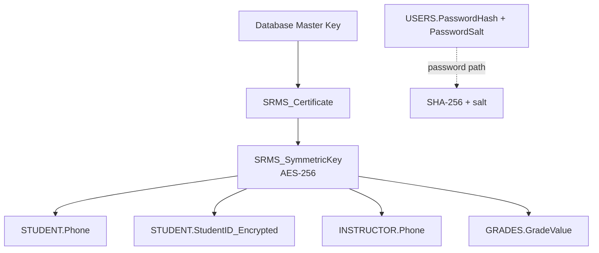

# 03 · Security models

SRMS implements five database-security models. This guide explains each model, maps it to code and SQL objects, states the expected outcomes, and records the limitations that matter in a review.

| Model | One-line purpose | Primary code |
| :-- | :-- | :-- |
| RBAC | Limit operations by role, table, and row ownership | `config.py`, `src/security/rbac.py` |
| MLS / Bell–LaPadula | Respect clearance for reads and prevent downward writes | `src/security/mls.py` |
| Inference control | Stop aggregates from isolating an individual | `src/security/inference_control.py` |
| Flow control | Block classified data from moving to a lower context | `src/security/flow_control.py` |
| Encryption | Protect sensitive values at rest and passwords in storage | `src/security/encryption.py`, SQL key hierarchy |

> [!WARNING]
> The project ships with public demo credentials and demo connection settings. The controls below are real code paths, but the deployment is not production-hardened. See [13 · Threat model](13-threat-model.md).

---

## 1. Role-Based Access Control

### Policy

Every principal has one role:

| Role | Clearance | Core responsibility |
| :-- | :--: | :-- |
| Admin | 4 | Users, roles, all records, audit, security operations |
| Instructor | 3 | Grades and academic decisions for assigned courses |
| TA | 2 | Attendance for assigned courses |
| Student | 1 | Own profile, published grades, own attendance, courses |
| Guest | 0 | Public course information |

The application matrix distinguishes:

- `SELECT`, `INSERT`, `UPDATE`, `DELETE` — full-table operations.
- `SELECT_OWN`, `UPDATE_OWN` — allowed only when `user_id == target_id`.
- `SELECT_PUBLIC` — a public projection.
- Explicit `deny()` — overrides a grant, like SQL `DENY`.

### Application matrix

| Table | Admin | Instructor | TA | Student | Guest |
| :-- | :-- | :-- | :-- | :-- | :-- |
| `STUDENT` | CRUD | R | R (assigned) | R (own) | — |
| `INSTRUCTOR` | CRUD | R, U (own) | — | — | — |
| `COURSE` | CRUD | R | R | R | R (public) |
| `GRADES` | CRUD | R, I, U (assigned) | — | R (own, published) | — |
| `ATTENDANCE` | CRUD | R (assigned) | R, I, U (assigned) | R (own) | — |
| `USERS` | CRUD | — | — | — | — |
| `ROLE_REQUESTS` | CRUD | R, I (own) | R, I (own) | R, I (own) | — |

The table above is the security intent. Assignment and publication filters are enforced in models, views, and dashboard queries; they are not encoded solely in the matrix.

### Code path

```python
from src.security.rbac import get_rbac_manager

rbac = get_rbac_manager()
allowed = rbac.has_permission(
    role="Student",
    table="GRADES",
    operation="SELECT",
    user_id=current_user_id,
    target_id=grade_owner_id,
)
```

Result object:

```python
rbac.check_access("TA", "GRADES", "SELECT")
# {
#   "granted": False,
#   "role": "TA",
#   "table": "GRADES",
#   "operation": "SELECT",
#   "clearance": 2,
#   "reason": "No permissions defined for TA on GRADES",
# }
```

### SQL Server mirror

`sql/sqlserver_roles.sql` creates `db_Admin`, `db_Instructor`, `db_TA`, `db_Student`, and `db_Guest`, grants the intended surface, and explicitly denies grade access to the TA role. The roles operate alongside the application matrix; both should be reviewed when changing policy.

### Own-row and assignment logic

| Restriction | Intended check |
| :-- | :-- |
| Student reads own profile | Linked `StudentID` equals the authenticated user's `LinkedID` |
| Student reads grades | Linked student and `IsPublished = 1` |
| Instructor grades | `COURSE.InstructorID` matches the instructor |
| TA attendance | `COURSE_ASSIGNMENT` links the TA to the course |
| Guest courses | `vw_PublicCourseInfo` only |

### Expected tests

| Test | Expected |
| :-- | :-- |
| Guest selects `GRADES` | Denied |
| Student updates a grade | Denied |
| TA selects `GRADES` | Denied in application and database |
| Instructor updates a grade for an assigned course | Allowed |
| Student selects another student's profile | Denied |
| Admin manages users | Allowed |

### Limitations

- The application matrix and SQL Server roles are separate definitions; drift is possible.
- Some model methods implement their own ownership filters rather than calling `RBACManager` for every path.
- Explicit runtime denials are not persisted.

---

## 2. Multilevel Security — Bell–LaPadula

### Classification lattice

```text
0 Public  <  1 Unclassified  <  2 Confidential  <  3 Secret  <  4 Top Secret
```

| Level | Name | Objects |
| :--: | :-- | :-- |
| 0 | Public | Public course projection |
| 1 | Unclassified | Course code, title, credits, description |
| 2 | Confidential | Student and instructor profiles |
| 3 | Secret | Grades, attendance, role requests |
| 4 | Top Secret | Users, audit log |

### Subject clearances

| Role | Clearance |
| :-- | :--: |
| Admin | 4 Top Secret |
| Instructor | 3 Secret |
| TA | 2 Confidential |
| Student | 1 Unclassified |
| Guest | 0 Public |

### Rules

**Simple security property — No Read Up (NRU):**

```text
read allowed  ⇔  subject clearance ≥ object classification
```

**Star property — No Write Down (NWD):**

```text
write allowed  ⇔  subject clearance ≤ object classification
```

Admin is treated as a trusted principal and may write at any level. The code makes this exception explicit.

### Code path

```python
from src.security.mls import get_mls_manager

mls = get_mls_manager()
result = mls.check_access("Student", "GRADES", "read")
# result["allowed"] is False
# result["reason"] starts with "NRU Violation"
```

Helpers:

| Method | Purpose |
| :-- | :-- |
| `can_read(clearance, classification)` | Pure NRU predicate |
| `can_write(clearance, classification)` | NWD predicate with trusted-admin exception |
| `check_access(role, table, operation)` | Structured decision with labels and reason |
| `get_accessible_tables(role, operation)` | Filter the classification map |
| `filter_records_by_clearance(records, clearance)` | Filter row dictionaries by classification field |
| `enforce_read_access()` / `enforce_write_access()` | Raise `MLSViolationError` on denial |

### The student-profile exception

A student's own profile is Confidential (2), but the Student role has global clearance 1. SRMS handles this as a controlled ownership exception:

- The student cannot read the `STUDENT` table generally.
- The `vw_StudentOwnProfile` view exposes only the linked student's authorised fields.
- The application applies an own-record check in addition to MLS.

This preserves the global clearance model while allowing a user to see their own record.

### SQL Server mirror

`sp_MLSReadCheck`, `sp_MLSWriteCheck`, and `sp_MLSAccessCheck` implement the same comparisons in T-SQL. They return a decision and reason suitable for audit or a calling procedure.

### Expected tests

| Test | Expected |
| :-- | :-- |
| Student reads grades | NRU denial |
| TA reads student profiles | Allowed at Confidential |
| Instructor reads confidential profiles | Allowed |
| Instructor reads users | NRU denial |
| Admin writes to Public | Allowed as trusted principal |
| Guest writes to Confidential | NWD denial |

### Limitations

- Clearance is derived from role, not from an independent attribute or data owner assignment.
- Admin's trusted-principal exception bypasses NWD; this is a deliberate policy choice.
- Classification is stored per table in `config.py`; row-level exceptions require additional checks.

---

## 3. Inference control

### Threat

An aggregate query can leak an individual value when the result set is too small, when MIN/MAX exposes an extreme, or when two complementary queries differ by one record.

### Controls

| Control | Value | Implementation |
| :-- | :--: | :-- |
| Minimum result-set size | 3 | `check_query_set_size`, `enforce_query_set_size` |
| MIN/MAX minimum | 6 | `validate_aggregate_query` |
| Query history | 50 per user | `track_query` |
| Tracker detection | symmetric difference = 1 | `check_tracker_attack` |
| Near-complementary warning | difference 1–2 | Medium-risk warning |
| Column redaction | Role-specific | `create_restricted_view` |
| Field anonymisation | Caller-supplied | `anonymize_results` |

### Decision flow

```text
result_count == 0                 → allow (no disclosure)
1 ≤ result_count < 3              → block
result_count ≥ 3, non-MIN/MAX     → allow
MIN/MAX and result_count < 6      → block
new set differs from history by 1 → high-risk tracker block
new set differs by 2              → medium-risk warning
```

### Code path

```python
from src.security.inference_control import get_inference_controller

inference = get_inference_controller()
decision = inference.validate_aggregate_query("AVG", result_count=2, user_role="TA")
# decision["allowed"] is False

inference.track_query(user_id=7, query_hash="grades:cs101", result_set={1, 2, 3})
tracker = inference.check_tracker_attack(user_id=7, new_result_set={1, 2})
# tracker["attack_detected"] is True, risk_level is high
```

### SQL Server mirror

`sp_GetCourseStatistics` checks the number of rows in the aggregate set and rejects a result below the configured minimum. The application tracker history is process-local and is not mirrored in SQL.

### Expected tests

| Test | Expected |
| :-- | :-- |
| COUNT over 2 records | Blocked |
| COUNT over 5 records | Allowed |
| MIN over 5 records | Blocked |
| MIN over 6 records | Allowed |
| Query pair differing by one record | High-risk tracker block |
| Guest restricted columns | Password, salt, contact, grade, clearance removed |

### Limitations

- Tracker history is in memory, per process, and is reset on restart.
- The tracker comparison is a heuristic; it does not prove intent.
- Redaction lists must be kept aligned with the schema.

---

## 4. Flow control

### Policy

Data may move upward or horizontally in classification, but not downward:

```text
target_classification ≥ source_classification  → allowed
target_classification < source_classification  → blocked
```

The action policy is stricter than the flow rule for export and certain UI actions:

| Action | Public | Unclassified | Confidential | Secret | Top Secret |
| :-- | :--: | :--: | :--: | :--: | :--: |
| View | ✅ | ✅ | ✅ | ✅ | ✅ |
| Export | ✅ | ✅ | ❌ | ❌ | ❌ |
| Print | ✅ | ✅ | ✅ | ❌ | ❌ |
| Copy | ✅ | ✅ | ✅ | ❌ | ❌ |
| Paste | ✅ | ✅ | ✅ | ❌ | ❌ |
| Save | ✅ | ✅ | ✅ | ❌ | ❌ |
| Screenshot | ✅ | ✅ | ✅ | ✅ | ❌ |

### Code path

```python
from src.security.flow_control import get_flow_controller

flow = get_flow_controller()
flow.can_flow(source_level=3, target_level=2)   # False
flow.can_export(3)                               # False
flow.lock_clipboard(3)
flow.is_clipboard_locked()                       # True
```

Methods and exceptions:

| Member | Purpose |
| :-- | :-- |
| `check_flow(source, target)` | Structured direction and reason |
| `check_action(classification, action)` | Action-level policy |
| `can_export`, `can_print`, `can_copy`, `can_save` | Convenience predicates |
| `lock_clipboard`, `unlock_clipboard`, `is_clipboard_locked` | Sensitive-context clipboard state |
| `get_allowed_actions`, `get_flow_matrix` | Inspection helpers |
| `enforce_flow`, `enforce_action` | Raise `FlowControlError` |

### SQL Server mirror

`sp_CheckDataFlow` compares source and target levels. `sp_CheckExportAllowed` rejects export requests for classifications above the allowed threshold. These procedures are useful when a data path lives entirely in SQL.

### Expected tests

| Test | Expected |
| :-- | :-- |
| Secret → Confidential | Blocked downflow |
| Public → Secret | Allowed upflow |
| Same level → same level | Allowed |
| Export Secret grades | Blocked |
| Print Top Secret | Blocked |
| Copy Secret data in the GUI | Blocked or disabled |
| Clipboard lock after viewing Secret data | Locked until context changes |

### Limitations

- Clipboard locking is cooperative; other applications cannot be controlled by SRMS.
- A screenshot is blocked at the UI policy level, not technically prevented on the desktop.
- Export utilities must call the flow controller; a new export path could bypass it if not reviewed.

---

## 5. Encryption

### Goals

- Sensitive fields should not be readable from a raw table dump.
- Passwords must be stored as hashes with a salt.
- Authorised application paths must be able to reveal values for display.
- The database layer should use a certificate-backed key hierarchy.

### SQL Server hierarchy



`sp_EncryptData` and `sp_DecryptData` wrap the key operations. `sp_InsertGrade` combines encryption with MLS checks.

### Application layer

`EncryptionManager` uses:

- `Fernet` authenticated encryption for values.
- `PBKDF2-HMAC-SHA256` with 100,000 iterations to derive a Fernet key from a master secret.
- `bcrypt` with cost 12 for password hashing on the SQLite/model path.
- A process singleton whose master secret comes from `SRMS_MASTER_KEY`, falling back to a published development key.

> [!NOTE]
> Fernet uses AES-128-CBC with HMAC-SHA256 in its standard construction. The project label “AES-256” refers to the SQL Server symmetric key and the intended 32-byte key length, not to the Fernet primitive. This guide uses the precise wording.

### Code path

```python
from src.security.encryption import get_encryption_manager

crypto = get_encryption_manager()
ciphertext = crypto.encrypt("Sensitive value")
plaintext = crypto.decrypt(ciphertext)

password_hash, salt = crypto.hash_password("correct horse battery staple")
crypto.verify_password("correct horse battery staple", password_hash)  # True
```

### Expected tests

| Test | Expected |
| :-- | :-- |
| Encrypt/decrypt round trip | Original value restored |
| Raw database select of encrypted field | Ciphertext, not plaintext |
| Password storage | Hash and salt, never plaintext |
| Wrong password | Verification returns `False` |
| Tampered ciphertext | `DecryptionError`, no plaintext returned |
| Missing key change | Fallback key warns in docs; production must set `SRMS_MASTER_KEY` |

### Limitations

- The fallback master key is published and must never protect real data.
- Fernet is used without per-record associated data.
- SQL Server and application encryption do not share one key lifecycle.
- Password hashing differs between SQL Server (SHA-256 + salt) and SQLite (bcrypt).
- Key rotation and envelope encryption are not implemented.

---

## Audit and accountability

The audit table records authentication and administrative activity, including:

- Action type and affected table.
- Record ID and user identity.
- Role and clearance at the time of the action.
- Data classification.
- Access result.
- Description, old/new values, IP address, and timestamp.

The admin dashboard exposes an audit view, and the Flask inspector provides `/audit`. Audit is a detective control; it does not replace prevention. The table is not append-only, and an administrator with direct database access can alter it.

---

## Cross-model examples

### Student opens own published grades

1. RBAC: `SELECT_OWN` on `GRADES`, linked student matches.
2. MLS: the student has a controlled own-record exception for the Confidential profile, but grade values are Secret. The application exposes only the published projection through the student view and model.
3. Inference: not an aggregate query.
4. Flow: view allowed; export and print blocked for Secret.
5. Encryption: the grade value is decrypted for authorised display.
6. Audit: access outcome recorded.

### TA opens attendance

1. RBAC: TA has `SELECT`, `INSERT`, `UPDATE` on `ATTENDANCE`, filtered to assigned courses.
2. MLS: TA clearance 2 cannot read Secret attendance by NRU. The UI path must use an authorised projection or an explicit assignment/ownership policy; this is a known policy tension in the current implementation.
3. Inference: not applicable.
4. Flow: view allowed; export blocked.
5. Audit: access outcome recorded.

> [!IMPORTANT]
> The TA attendance case exposes an important review point: a global role clearance and a per-course delegated duty can conflict. The database views and assignment filters express the delegated duty, but the pure MLS check would deny a Confidential-clearance TA access to Secret attendance. This should be resolved explicitly in a future policy design, either by raising the TA clearance, lowering attendance classification, or introducing a delegated-access rule.

### Guest browses courses

1. RBAC: `SELECT_PUBLIC` on `COURSE`.
2. MLS: public classification only.
3. Inference: no aggregate access.
4. Flow: view allowed; no classified export.
5. Encryption: no sensitive fields exposed.
6. Audit: public access may be logged by the viewer or application path.

---

## Configuration map

| Setting | File | Meaning |
| :-- | :-- | :-- |
| `SecurityLevel` | `config.py` | Numeric classification levels |
| `ROLE_CLEARANCE` | `config.py` | Role-to-clearance map |
| `DATA_CLASSIFICATION` | `config.py` | Table-to-classification map |
| `PERMISSION_MATRIX` | `config.py` | Application RBAC rules |
| `MIN_QUERY_SET_SIZE` | `config.py` | Inference threshold |
| `BLOCKED_ACTIONS` | `config.py` | Flow action policy |
| `SRMS_MASTER_KEY` | Environment | Application encryption secret |
| SQL role grants | `sql/sqlserver_roles.sql` | Database RBAC |
| MLS procedures | `sql/sqlserver_procedures.sql` | Database MLS checks |

---

## Production hardening priorities

1. Remove all demo credentials and the `SA` application path.
2. Choose one password-hashing scheme and migrate all accounts.
3. Replace the published fallback encryption key with a vault-backed secret.
4. Define a single key lifecycle and rotation process.
5. Resolve the TA clearance/attendance policy tension explicitly.
6. Add automated negative tests for each control.
7. Make audit append-only or export it to an external store.
8. Put the Flask viewer behind authentication or remove it from production images.
9. Add TLS, rate limiting, and secure session handling.
10. Conduct an independent review before handling real records.

---

## Related reading

- [04 · Database reference](04-database-reference.md)
- [07 · Testing](07-testing.md)
- [13 · Threat model](13-threat-model.md)
- [16 · Role workflow](16-role-workflow.md)
