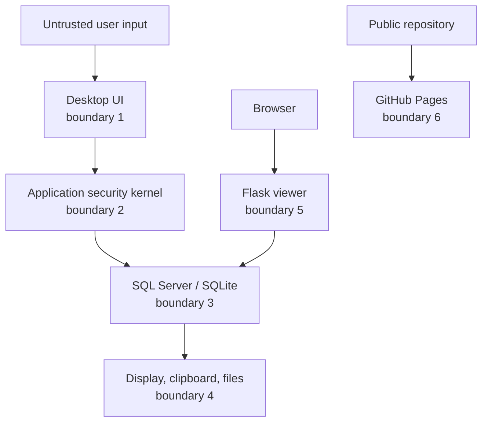

# 13 · Threat model

This threat model describes the assets, actors, trust boundaries, threats, and residual risks of SRMS. It is written for a classroom reference implementation, not a certified production system.

> [!IMPORTANT]
> The most important residual risks are the published demo credentials, the `SA` application path, hard-coded connection settings, simulated authentication factors, and the absence of automated security tests.

---

## Scope

### In scope

- The Tkinter desktop client.
- SQL Server 2022 and the SQLite fallback.
- The local Flask database viewer.
- The SQL scripts, demo backup, and sample data.
- The static documentation website and repository metadata.
- The role-upgrade workflow.

### Out of scope

- Production identity providers.
- Institution-wide network security.
- Endpoint management.
- Physical security.
- Regulatory certification.
- Real student records.

---

## Assets

| Asset | Confidentiality | Integrity | Availability | Why it matters |
| :-- | :--: | :--: | :--: | :-- |
| Student identity and contact data | High | High | Medium | Personal data and privacy |
| Grades and attendance | High | High | Medium | Academic decisions |
| User credentials and salts | High | High | High | Account takeover |
| Encryption keys | Critical | Critical | High | Bulk data disclosure |
| Role and clearance assignments | High | Critical | High | Authorization bypass |
| Audit log | High | Critical | Medium | Accountability and investigation |
| Role requests | Medium | High | Medium | Privilege escalation |
| SQL Server backup | High | High | Medium | Full database disclosure |
| Source and documentation | Low | Medium | Medium | Trust and reproducibility |

---

## Actors

| Actor | Trust level | Capability |
| :-- | :-- | :-- |
| Guest | Untrusted | Public read |
| Student | Low | Own records, request submission |
| TA | Medium | Assigned attendance, assigned roster |
| Instructor | Medium-high | Assigned grades and rosters |
| Admin | High | User, role, audit, security operations |
| DBA / operator | Critical | Direct database and key access |
| Developer / contributor | High | Source, build, and release access |
| Reviewer / instructor | Trusted reader | Demo access and code review |
| Internet visitor | Untrusted | Public repository and Pages site |

The DBA is deliberately included: an administrator with direct database access can bypass application controls and alter audit data.

---

## Trust boundaries

| Boundary | Threat | Primary controls |
| :--: | :-- | :-- |
| 1 | Malicious or malformed input | Validation, parameterisation, generic errors |
| 2 | Bypassing policy from a dashboard | Central managers, code review, tests |
| 3 | Direct database access or privilege misuse | Roles, grants, stored procedures, network restriction |
| 4 | Downflow, export, clipboard leak | Flow controller and UI action policy |
| 5 | Unauthenticated local inspection | Localhost binding, read-only queries, allow-list |
| 6 | Secret or personal data in public repo | Review, `.gitignore`, secret scanning, demo-only policy |

---

## Threat scenarios

### T1 — Guest accesses confidential data

**Path:** Guest calls a hidden route or queries a table directly.

**Impact:** High — privacy breach.

**Likelihood:** Medium in a misconfigured build.

**Mitigation:** Guest role has public-only permissions; `vw_PublicCourseInfo`; database denials; dashboard scoping; negative tests.

**Residual risk:** If the application connects as `SA`, database grants do not constrain the Guest UI. The application checks are the effective boundary.

---

### T2 — Student reads another student's grades

**Path:** Manipulated target ID, direct query, or a dashboard that forgets the own-row filter.

**Impact:** High.

**Mitigation:** `SELECT_OWN` checks, linked-record filter, `vw_StudentOwnGrades`, published-only condition, model-level filtering, test cases.

**Residual risk:** Any model path that bypasses the shared ownership check can expose data. Automated integration tests are missing.

---

### T3 — TA reads grades

**Path:** Hidden UI route, direct SQL, or a shared export utility.

**Impact:** High — academic integrity.

**Mitigation:** Empty `GRADES` permission for TA, explicit database `DENY`, dashboard exclusion, test case.

**Residual risk:** A future feature could add a TA query without updating the matrix. Review and tests are required.

---

### T4 — Instructor writes an unassigned course's grades

**Path:** Reused grade form with a manipulated course ID.

**Impact:** High.

**Mitigation:** Assignment filter in views and model queries; instructor ID check; denial test.

**Residual risk:** The application has multiple query paths; not all are covered by automated tests.

---

### T5 — Inference attack on small aggregates

**Path:** Repeated small aggregate or complementary queries.

**Impact:** Medium-high — individual grade disclosure.

**Mitigation:** Minimum set size 3, MIN/MAX threshold 6, tracker detection, 50-query history.

**Residual risk:** History is per process and in memory; restarting clears it. The heuristic is not a formal privacy guarantee.

---

### T6 — Downflow or export leak

**Path:** Export Secret grades, copy to clipboard, print a transcript, save a report.

**Impact:** High.

**Mitigation:** `FlowController` action matrix, disabled UI actions, database flow procedures, classification banners.

**Residual risk:** Cooperative UI controls cannot prevent screenshots or an external process. New export code may bypass the check if not reviewed.

---

### T7 — Credential stuffing or brute force

**Path:** Repeated login attempts with common passwords.

**Impact:** High — account takeover.

**Mitigation:** Five-attempt lockout, failed-login audit.

**Residual risk:** No IP rate limiting, no CAPTCHA, no adaptive throttling, and demo passwords are weak and public.

---

### T8 — Password database disclosure

**Path:** Database backup, direct query, or stolen file.

**Impact:** Critical.

**Mitigation:** SHA-256 + salt or bcrypt, no plaintext passwords, encrypted backup recommended.

**Residual risk:** SHA-256 is not memory-hard. Published demo passwords are trivially cracked. The backup is not encrypted.

---

### T9 — Encryption key compromise

**Path:** Source inspection, environment leak, or stolen backup.

**Impact:** Critical — decryption of sensitive fields.

**Mitigation:** `SRMS_MASTER_KEY` environment variable, SQL Server certificate key hierarchy.

**Residual risk:** The fallback key is published; key rotation and a vault are absent. SQL and application encryption have separate lifecycles.

---

### T10 — Audit tampering

**Path:** DBA updates or deletes `AUDIT_LOG` records.

**Impact:** High — loss of accountability.

**Mitigation:** Admin-only access, audit review view.

**Residual risk:** The table is mutable. No hash chain or external append-only store exists.

---

### T11 — Privilege escalation through role requests

**Path:** Student submits a forged or duplicate request, or manipulates the approval path.

**Impact:** High.

**Mitigation:** Requested roles limited to TA/Instructor, Pending state, admin-only processing, audit, validation.

**Residual risk:** The approval path needs negative tests. A direct database update can bypass the workflow entirely.

---

### T12 — Secrets or personal data committed to the repository

**Path:** Developer adds a `.env`, key, real CSV, or database dump.

**Impact:** Critical.

**Mitigation:** `.gitignore`, public policy, secret scanning recommendation, code review.

**Residual risk:** Git history is permanent. If a secret is committed, rotate it immediately; deleting the file is not enough.

---

### T13 — Unauthenticated Flask viewer

**Path:** Network access to port 5000 or a reverse proxy mistake.

**Impact:** High — data disclosure and schema reconnaissance.

**Mitigation:** Bind to localhost, read-only allow-list, no debug mode.

**Residual risk:** The default `app.run()` may bind more broadly depending on how it is started. Operators must verify the bind address.

---

### T14 — SQL injection

**Path:** Unsafe string interpolation in a query or the ad-hoc viewer.

**Impact:** High.

**Mitigation:** Parameterised queries, allow-listed table names, read-only viewer.

**Residual risk:** The codebase has not had an exhaustive injection audit. Some legacy functions build SQL fragments.

---

### T15 — Malicious database backup

**Path:** Restoring an untrusted `.bak` into a privileged server.

**Impact:** High — arbitrary database objects or code.

**Mitigation:** Use only the repository backup in a disposable environment.

**Residual risk:** There is no signature or checksum verification in the restore instructions.

---

### T16 — Supply-chain compromise

**Path:** A malicious dependency or GitHub Action.

**Impact:** High.

**Mitigation:** Pinned GitHub Actions recommended, Dependabot, minimal permissions, review of dependency updates.

**Residual risk:** Python dependencies are version-ranged, not locked with hashes.

---

## STRIDE summary

| STRIDE | Example | Mitigation | Residual risk |
| :-- | :-- | :-- | :-- |
| **S**poofing | Stolen demo password | Lockout, audit, strong credentials planned | Weak public demo passwords |
| **T**ampering | Modify a grade or audit row | RBAC, MLS write checks, audit | Direct DBA access |
| **R**epudiation | Deny performing an action | Audit trail with actor and outcome | Mutable audit table |
| **I**nformation disclosure | Small aggregate, export, viewer | Inference, flow, roles, localhost viewer | Heuristic controls; screenshots |
| **D**enial of service | Lock every account | Lockout is deliberate | No rate limit or recovery workflow |
| **E**levation of privilege | Forge role request | Admin approval, validation, audit | No automated negative tests |

---

## Risk matrix

| Risk | Likelihood | Impact | Priority |
| :-- | :--: | :--: | :--: |
| Public demo credentials | Certain | High | Critical |
| `SA` application login | Certain | High | Critical |
| Hard-coded connection settings | Certain | High | Critical |
| No automated security tests | High | High | Critical |
| Mutable audit log | Medium | High | High |
| Flask viewer exposed | Medium | High | High |
| TA/MLS policy conflict | Medium | Medium | High |
| Mixed password hashing | Certain | Medium | High |
| Published encryption key | Certain | Critical | Critical |
| Inference history reset | Medium | Medium | Medium |
| Supply-chain drift | Medium | High | Medium |

---

## Security requirements traceability

| Requirement | Implementation | Evidence |
| :-- | :-- | :-- |
| Role-based access | `PERMISSION_MATRIX`, `RBACManager`, SQL roles | [03](03-security-models.md), [04](04-database-reference.md) |
| Multilevel security | `MLSManager`, `sp_MLS*` | [03](03-security-models.md) |
| Inference control | `InferenceController`, `sp_GetCourseStatistics` | [03](03-security-models.md) |
| Flow control | `FlowController`, `sp_Check*` | [03](03-security-models.md) |
| Encryption at rest | AES-256 key hierarchy, Fernet, bcrypt | [04](04-database-reference.md) |
| Auditability | `AUDIT_LOG`, admin view, viewer route | [06](06-user-guide.md) |
| Governed privilege change | `ROLE_REQUESTS`, admin workflow, audit | [16](16-role-workflow.md) |
| Demo-only safety | Public warnings, threat model, policy | [SECURITY](../SECURITY.md) |

---

## Production readiness statement

SRMS is **not production-ready**. It is suitable for:

- Classroom demonstrations.
- Security education.
- Code review exercises.
- Documentation and threat-model study.

It is not suitable for:

- Real student records.
- Public internet exposure.
- Regulated data.
- Institutional decision-making without independent review.

---

## Review cadence

Revisit this threat model when:

- A new role, table, or data classification is added.
- Authentication or encryption changes.
- A new export or network path is added.
- A vulnerability is reported.
- A release changes deployment assumptions.

Update the [roadmap](12-roadmap.md) and [testing guide](07-testing.md) with any new mitigation.

---

## Related reading

- [SECURITY](../SECURITY.md)
- [03 · Security models](03-security-models.md)
- [07 · Testing](07-testing.md)
- [09 · Deployment](09-deployment.md)
