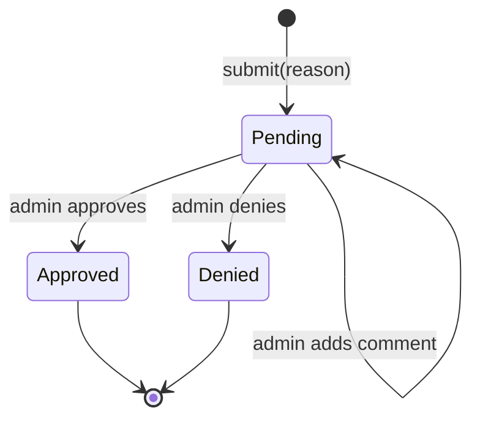
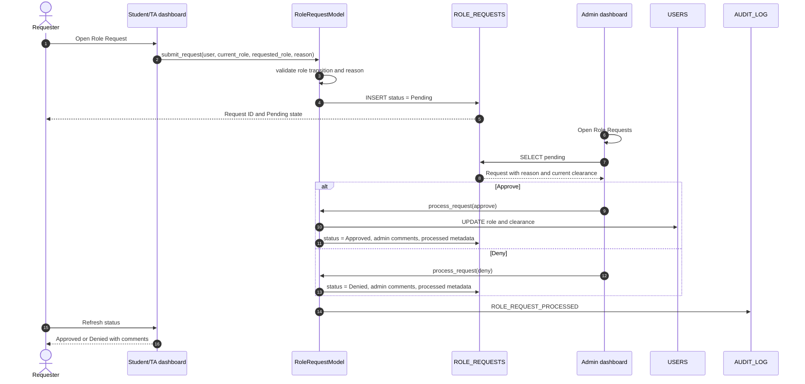

# 16 · Role workflow

The role-upgrade workflow is the Part B feature: a governed path for a Student or TA to request a higher role, with an administrator approving or denying the request and every transition audited.

---

## Why the workflow exists

Without a workflow, privilege changes happen through ad hoc database edits or informal requests. The workflow provides:

- A recorded reason from the requester.
- A single administrative decision point.
- A visible status for the requester.
- An audit trail for the decision.
- A consistent clearance update after approval.

It is **not** a production identity-governance system. It has no separation-of-duties enforcement, approval quorum, expiry, or automated review.

---

## Roles and allowed transitions

| Current role | Can request | Requested clearance | Admin action |
| :-- | :-- | :--: | :-- |
| Student | TA or Instructor | 2 or 3 | Approve or deny |
| TA | Instructor | 3 | Approve or deny |
| Instructor | — | — | Not a request path |
| Admin | — | — | Not a request path |
| Guest | — | — | Not allowed |

The database constrains `RequestedRole` to `TA` or `Instructor`.

---

## State model

Only `Pending` requests can be processed. A processed request cannot be approved or denied again without a new request.

---

## End-to-end sequence

---

## Submission

### Inputs

| Field | Source | Validation |
| :-- | :-- | :-- |
| `UserID` | Authenticated user | Must exist |
| `Username` | Authenticated user | Snapshot |
| `CurrentRole` | Authenticated user | Must be Student or TA |
| `RequestedRole` | Requester | TA or Instructor |
| `CurrentClearance` | Role map | 1 or 2 |
| `RequestedClearance` | Role map | 2 or 3 |
| `Reason` | Requester | Required, non-empty, reasonable length |
| `Status` | Model default | Pending |

### Rules

1. The requester must be authenticated.
2. Only Student and TA may submit.
3. The requested role must be higher than the current role.
4. The reason must be present.
5. Duplicate pending requests should be rejected.
6. The request is written with `Pending` status.
7. The submission is audited.

### Code path

The domain model is `RoleRequestModel` in `src/database/models.py`. The SQL Server path also provides `sp_SubmitRoleRequest`; the application may use either depending on the connection path.

Expected result:

- A new row in `ROLE_REQUESTS`.
- `Status = Pending`.
- A visible pending badge or row in the requester's dashboard.
- An audit event.

### Failure cases

| Case | Expected |
| :-- | :-- |
| Empty reason | Validation error, no row |
| Requested role missing | Validation error |
| Invalid transition | Rejected |
| Duplicate pending request | Rejected or deduplicated |
| Unauthenticated call | Denied |

---

## Admin review

The admin dashboard lists pending requests. Each row should show:

- Request ID.
- Username and user ID.
- Current role and requested role.
- Current and requested clearance.
- Reason.
- Submission date.
- Status.

The admin selects a request, reads the reason, adds comments, and chooses **Approve** or **Deny**.

### Approval

1. Verify the request is still pending.
2. Verify the target role is allowed.
3. Update `USERS.Role` and `USERS.ClearanceLevel`.
4. Update `ROLE_REQUESTS.Status = 'Approved'`.
5. Set `DateProcessed`, `ProcessedBy`, `ProcessedByUsername`, and `AdminComments`.
6. Write an audit event with old and new values.
7. Commit atomically.

If the user update succeeds but the request update fails, the transaction must roll back. A role change without a recorded decision is an audit gap.

### Denial

1. Verify the request is still pending.
2. Leave the user's role and clearance unchanged.
3. Update `Status = 'Denied'`.
4. Store the admin's comments and processing metadata.
5. Write an audit event.
6. Commit.

### Concurrency

Two admins could attempt to process the same request. The database update should include a `Status = 'Pending'` predicate and the application should check the affected row count. A zero-row update means another admin already processed it.

---

## Requester view

The requester sees their own request history:

- Status.
- Requested role.
- Submission date.
- Processing date.
- Admin comments.
- Current role.

The requester must not see other users' requests. The `SELECT_OWN` permission and a model filter enforce this.

---

## Audit events

Recommended event types:

| Event | When | Fields |
| :-- | :-- | :-- |
| `ROLE_REQUEST_SUBMITTED` | Request created | actor, requested role, reason summary, request ID |
| `ROLE_REQUEST_APPROVED` | Approval committed | actor, request ID, old role, new role, comments |
| `ROLE_REQUEST_DENIED` | Denial committed | actor, request ID, current role, comments |
| `ROLE_REQUEST_INVALID` | Validation failure | actor, reason category |

Do not store secrets. Be careful with free-text reasons and comments: they may contain personal data and are visible to the admin and requester.

---

## Database objects

| Object | Role |
| :-- | :-- |
| `ROLE_REQUESTS` | Request state |
| `USERS` | Current role and clearance |
| `vw_PendingRoleRequests` | Admin pending list |
| `sp_SubmitRoleRequest` | Submission path |
| `sp_GetPendingRoleRequests` | Pending query |
| `sp_ProcessRoleRequest` | Approval/denial path |
| `AUDIT_LOG` | Decision evidence |

See [04 · Database reference](04-database-reference.md) for columns and procedures.

---

## Application objects

| Object | Location | Role |
| :-- | :-- | :-- |
| `RoleRequestModel` | `src/database/models.py` | Domain logic and persistence |
| `SQLServerRoleRequestModel` | `src/database/sqlserver_connection.py` | SQL Server helper |
| Role-request tab | Student, TA dashboards | Submission and status |
| Pending request view | Admin dashboard | Review and decision |
| `BulkOperations` | `src/security/advanced_security.py` | Related bulk admin actions |

The model is the source of truth for validation. A dashboard should not write directly to `ROLE_REQUESTS`.

---

## Security analysis

### Threats

| Threat | Control |
| :-- | :-- |
| Student self-approves | Admin-only processing, no UPDATE permission for requester |
| Forged current role | Use the authenticated user record, not client input |
| Privilege jump to Admin | Requested roles limited to TA/Instructor |
| Duplicate approval | Pending-state predicate and row-count check |
| Hidden request manipulation | Own-row read, admin-only pending view |
| Repudiation | Audit event with actor and decision |
| Reason contains sensitive data | Guidance and review; no automated redaction |

### Residual risks

- A database administrator can update `USERS` directly and bypass the workflow.
- There is no separation-of-duties or multi-admin approval.
- The workflow does not expire or revoke a role.
- Comments are free text and may contain personal data.
- No automated end-to-end test proves every transition.

---

## Test cases

| ID | Action | Expected |
| :-- | :-- | :-- |
| `TC-PB-01` | Student submits TA request with a reason | Pending row, submission audit |
| `TC-PB-02` | Student submits with empty reason | Rejected, no row |
| `TC-PB-03` | Student requests Admin | Rejected |
| `TC-PB-04` | TA requests Instructor | Pending |
| `TC-PB-05` | Admin approves | Role and clearance updated atomically |
| `TC-PB-06` | Admin denies | Role unchanged, comments stored |
| `TC-PB-07` | Second admin processes a processed request | Rejected |
| `TC-PB-08` | Student reads another user's request | Denied |
| `TC-PB-09` | Requester refreshes status | Sees decision and comments |
| `TC-PB-10` | Audit view | Approval/denial event visible |

---

## Manual demonstration script

For a course review:

1. Sign in as `student1`.
2. Open **Role Request**.
3. Request **TA** with a short reason.
4. Confirm the request appears as **Pending**.
5. Sign out and sign in as `admin`.
6. Open **Role Requests**.
7. Read the request and add a comment.
8. Approve it.
9. Confirm the user's role and clearance changed.
10. Show the audit entry.
11. Sign in as the requester and confirm the approved status and comment.
12. Repeat with a second account and deny it; confirm the role is unchanged.

If the demo cannot complete a step, record the failure and the audit state. Do not edit the database to make the demo pass without disclosing the change.

---

## Production improvements

- Add approval quorum or separation of duties.
- Add request expiry and reminders.
- Add a reason/comment classification and redaction policy.
- Add role-change notifications.
- Add a time-bound role grant with automatic expiry.
- Add an immutable audit event.
- Add automated tests for every transition.
- Add a policy that prevents direct `USERS` role updates outside the workflow.

---

## Related reading

- [03 · Security models](03-security-models.md)
- [04 · Database reference](04-database-reference.md)
- [06 · User guide](06-user-guide.md)
- [07 · Testing](07-testing.md)
- [13 · Threat model](13-threat-model.md)
